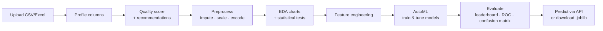
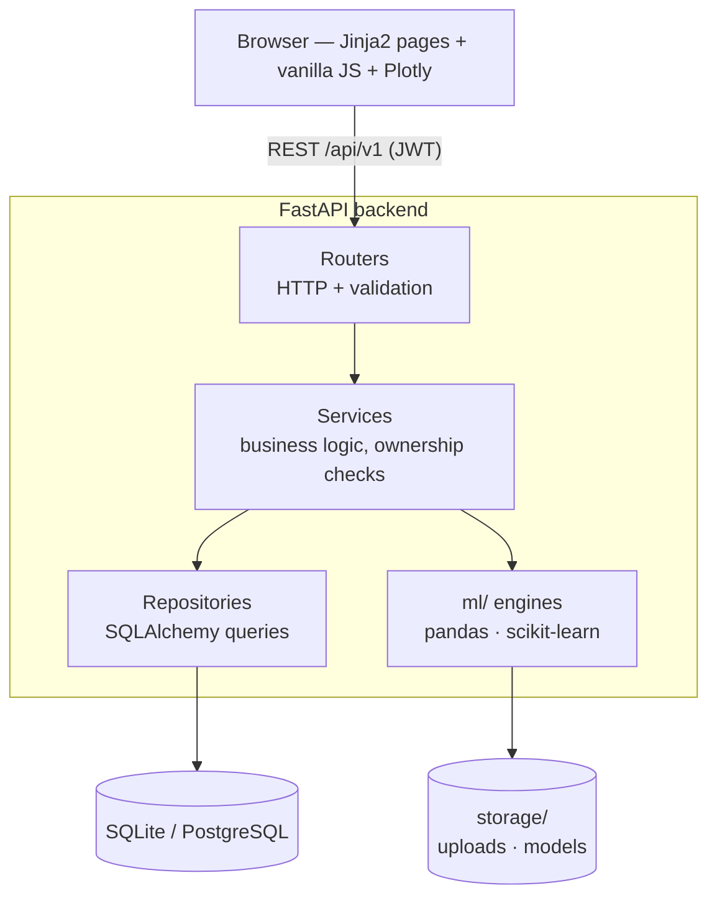

# AI BI Platform — No-code AutoML

> A full-stack, no-code machine-learning platform: upload a CSV or Excel file and go from raw data to a profiled, cleaned and explored dataset, then to a **trained, evaluated and downloadable model**, entirely in the browser.


---

## What it does



| Phase | Module | Highlights |
|---|---|---|
| 0 | Planning | SRS, architecture, ER diagram, API design ([docs/PHASE_0_PLANNING.md](docs/PHASE_0_PLANNING.md)) |
| 1 | Project setup | FastAPI app, async SQLAlchemy, Alembic, Jinja2 + Tailwind UI |
| 2 | Authentication | JWT access/refresh tokens with rotation and revocation, bcrypt, password reset, change password (signs out other devices) |
| 3 | Dashboard | Live counts (datasets, experiments, trained models, average quality score), recent datasets and experiments |
| 4 | Dataset upload | CSV/Excel, size and type validation, SHA-256 duplicate detection, preview |
| 5 | Profiling | Column type detection, descriptive statistics, missing and unique counts |
| 6 | Data quality | Missing values, IQR/Z-score outliers, correlation, skew, class imbalance, 0–100 score |
| 7 | Preprocessing | Mean/median/mode, KNN and MICE imputation, outlier handling, scaling, power transforms, encoding, resampling, before/after preview |
| 8 | EDA | Distributions, heatmaps, target-aware tests (Pearson, ANOVA, Kruskal-Wallis, χ² + Cramér's V) |
| 9 | Feature engineering | Date parts, interactions, polynomials, text stats, PCA, mutual-information selection |
| **10** | **AutoML** | Task auto-detection, algorithm recommendations, sklearn pipelines, k-fold CV, randomized hyperparameter search |
| **11** | **Model evaluation** | Leaderboard, best-model selection, metrics, confusion matrix, ROC and PR curves, residuals, permutation importance, live prediction, model download |

---

## AutoML engine (Phases 10–11)

The engine (`backend/app/ml/automl.py`, `backend/app/ml/evaluator.py`) is plain Python with no web or database code, so it is unit-tested on its own.

1. **Detect the task** from the target column: binary, multiclass or regression.
2. **Prepare data.** Drop columns that would hurt or leak (row IDs, constants, free text), recording the reason for each, and label-encode the target.
3. **Build one pipeline per algorithm:** `impute → scale / one-hot → model`. Because preprocessing lives inside the pipeline, it is re-fit inside every CV fold, so there's no data leakage, and the saved model accepts raw rows.
4. **Select by cross-validation** (stratified k-fold for classification), optionally with `RandomizedSearchCV` tuning.
5. **Report on a held-out test split** that was never used for model selection, so the reported score is unbiased.
6. **Persist** each model as a `.joblib` bundle (pipeline + metadata) for the prediction API and download.

| Classification | Regression |
|---|---|
| Logistic Regression, Decision Tree, Random Forest, Extra Trees, Histogram Gradient Boosting, KNN, calibrated SVM | Linear, Ridge, Lasso, ElasticNet, Decision Tree, Random Forest, Extra Trees, Histogram Gradient Boosting, KNN, SVR |

XGBoost and LightGBM are picked up automatically if installed (`pip install xgboost lightgbm`); they are not required.

**Metrics:**
- Classification: accuracy, precision, recall and F1 (weighted and macro), ROC-AUC, log loss.
- Regression: MAE, MSE, RMSE, R², adjusted R², MAPE.

---

## Architecture



- **Layered design:** routers stay thin, services hold the logic, repositories own SQL, and `ml/` is framework-free.
- **Async I/O:** CPU-heavy training runs in a worker thread (`run_in_threadpool`) so the server stays responsive.
- **Multi-tenant:** every query is scoped by `user_id`, and other users' resources return 404.
- **Migrations:** 9 Alembic revisions, checked in CI with `alembic check`.
- **API:** 45 REST endpoints, documented automatically at `/docs`.

---

## Tech stack

| Layer | Technologies |
|---|---|
| Backend | Python 3.12, FastAPI, SQLAlchemy 2.0 (async), Alembic, Pydantic v2 |
| ML / data | scikit-learn, pandas, NumPy, SciPy, joblib (optional: XGBoost, LightGBM) |
| Frontend | Jinja2 templates, Tailwind CSS, vanilla JavaScript, Plotly.js |
| Database | SQLite (default, zero setup) or PostgreSQL (`asyncpg`) |
| Auth | JWT (access + refresh with rotation), bcrypt |
| DevOps | Docker, Docker Compose, GitHub Actions (migrations + tests) |
| Testing | pytest, pytest-asyncio, httpx (98 tests) + Playwright end-to-end run |

---

## Quick start

**Prerequisites:** Python 3.12 (3.11+ works). No database server is needed.

```bash
git clone <repository-url>
cd auto_ml_pipline/backend

python -m venv venv
venv\Scripts\activate            # Windows
# source venv/bin/activate       # macOS / Linux

pip install -r requirements-dev.txt   # runtime + test tools (~350 MB, no PyTorch)
copy .env.example .env                # Windows  (cp .env.example .env on macOS/Linux)

alembic upgrade head                  # creates ai_bi_platform.db (SQLite)
uvicorn app.main:app --reload
```

Open http://localhost:8000. The API docs are at http://localhost:8000/docs.

**Demo flow:** Register → Datasets → upload a CSV → Profiling / Quality / EDA → **Train Models** → pick a target → **Train & compare** → open the leaderboard and evaluation → try a prediction → download the model.

### With Docker (PostgreSQL)

```bash
docker compose up --build        # migrations run automatically on start
```

---

## Using a trained model

**Through the API** (the same call the "Try a prediction" panel makes):

```bash
curl -X POST http://localhost:8000/api/v1/experiments/<experiment_id>/models/<model_id>/predict \
  -H "Authorization: Bearer <token>" -H "Content-Type: application/json" \
  -d '{"rows": [{"tenure_months": 3, "plan": "basic", "monthly_bill": 110, "support_calls": 6}]}'
```

**Outside the platform** (downloaded `.joblib`):

```python
import joblib, pandas as pd

bundle = joblib.load("random_forest_churned.joblib")
X = pd.DataFrame([{"tenure_months": 3, "plan": "basic", "monthly_bill": 110, "support_calls": 6}])
label_index = bundle["pipeline"].predict(X)[0]
print(bundle["class_labels"][label_index])   # e.g. "yes"
```

---

## Project structure

```
auto_ml_pipline/
├── backend/
│   ├── app/
│   │   ├── main.py            # FastAPI app, routers, page routes
│   │   ├── config.py          # Pydantic settings (env-driven)
│   │   ├── database.py        # Async engine/session, SQLite FK enforcement
│   │   ├── core/              # JWT & bcrypt, exceptions, logging
│   │   ├── routers/           # HTTP endpoints (auth, datasets, …, experiments)
│   │   ├── services/          # Business logic
│   │   ├── repositories/      # Database access
│   │   ├── models/            # SQLAlchemy ORM models
│   │   ├── schemas/           # Pydantic request/response models
│   │   ├── ml/                # profiler, quality, preprocessor, EDA, features, automl, evaluator
│   │   └── utils/
│   ├── alembic/               # 9 migrations
│   ├── tests/                 # 98 tests (API, ML engines, audit regressions)
│   ├── requirements.txt       # runtime deps
│   └── requirements-dev.txt   # + pytest, httpx
├── frontend/
│   ├── templates/             # Jinja2 pages & components
│   └── static/js/             # one script per page + shared utils
├── storage/                   # uploads/ and models/ (git-ignored)
├── docker/ · docker-compose.yml · .github/workflows/ci.yml
└── docs/                      # planning, dev log, interview guide
```

---

## Testing

```bash
cd backend
pytest -q          # 98 tests: auth, datasets, profiling, quality, preprocessing, EDA, features, AutoML, experiments, regressions
```

Tests use an in-memory SQLite database and temporary storage folders, so they need no setup and leave nothing behind.

---

## Configuration

All settings come from `backend/.env` (see `backend/.env.example`):

| Variable | Default | Purpose |
|---|---|---|
| `DATABASE_URL` | `sqlite+aiosqlite:///./ai_bi_platform.db` | Use `postgresql+asyncpg://…` in production |
| `SECRET_KEY` | placeholder (startup warning) | JWT signing key; set a random value |
| `DEBUG` | `false` | When on, forgot-password returns the reset link (no email service yet) |
| `UPLOAD_DIR` / `MODELS_DIR` | `../storage/uploads` / `../storage/models` | File storage |
| `MAX_UPLOAD_SIZE` | `104857600` (100 MB) | Upload limit |
| `AUTOML_MAX_ROWS` | `50000` | Larger datasets are down-sampled (stratified) before training |
| `ML_N_JOBS` | `1` | Parallel CV/tuning jobs (`-1` = all cores) |

---

## Design decisions

- **scikit-learn only by default.** This keeps the install around 350 MB instead of several GB. Histogram Gradient Boosting gives boosting-level accuracy without extra dependencies.
- **Select on CV, report on test.** Picking the winner on the test set would overstate its accuracy.
- **Pipelines, not pre-transformed data.** This makes the workflow leakage-safe, and the downloaded model works on raw input.
- **Permutation importance.** It's model-agnostic, so every algorithm is explained the same way, in terms of the original columns.
- **Synchronous training in a thread pool.** It's simple and predictable for datasets up to the row cap. A task queue (Celery/RQ) is the next step for long jobs.
- **SQLite by default, PostgreSQL in Docker.** One command to run locally, production-grade when deployed.

## Documentation

- [docs/INTERVIEW_GUIDE.md](docs/INTERVIEW_GUIDE.md): how to pitch and explain this project, resume bullets, likely interview questions
- [docs/DEVELOPMENT_LOG.md](docs/DEVELOPMENT_LOG.md): what changed and why
- [docs/PHASE_0_PLANNING.md](docs/PHASE_0_PLANNING.md): original requirements and system design

## Roadmap (not implemented)

Explainability (SHAP), time-series forecasting, anomaly detection, a natural-language assistant, report export, and a background job queue for long training runs.

## License

MIT
