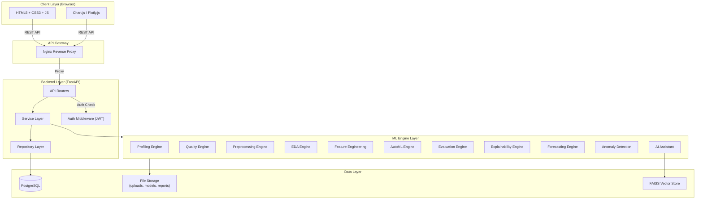
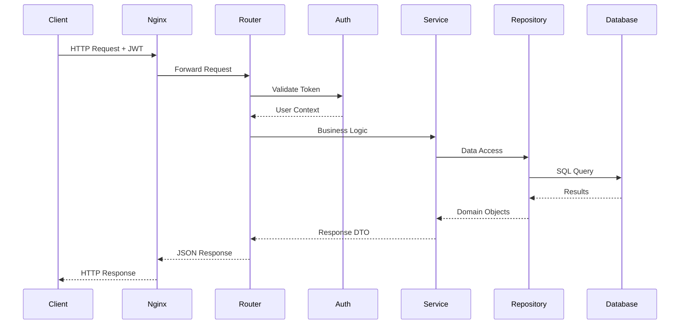
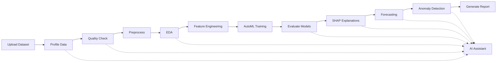
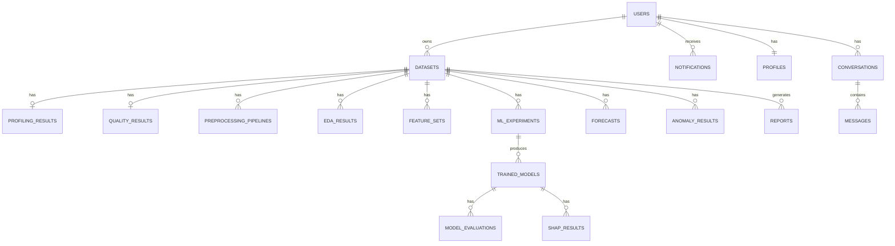
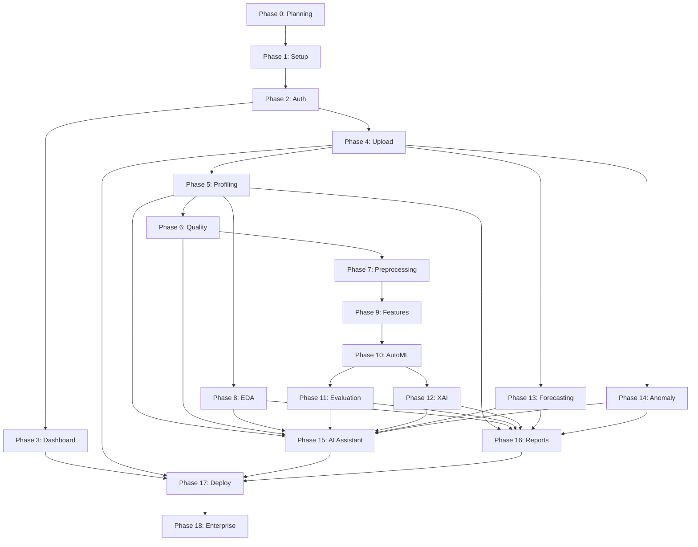

# PHASE 0 — Planning & System Design

> **AI-Powered Business Intelligence Platform**
> **Date:** 2026-07-12 · **Phase Status:** Complete — Awaiting Approval

---

## Table of Contents

1. [Problem Statement](#1-problem-statement)
2. [Software Requirements Specification (SRS)](#2-software-requirements-specification-srs)
3. [Architecture Diagram](#3-architecture-diagram)
4. [Database Design](#4-database-design)
5. [API Design](#5-api-design)
6. [Folder Structure](#6-folder-structure)
7. [Wireframes](#7-wireframes)
8. [Development Plan](#8-development-plan)

---

## 1. Problem Statement

### Context
Organizations across industries accumulate large volumes of tabular data (sales records, customer databases, financial reports, operational logs) in CSV and Excel formats. Extracting actionable intelligence from this data typically requires:
- A data engineer to clean and transform the data
- A data scientist to build and evaluate models
- A BI analyst to create visualizations and reports
- Separate tools for each step (Jupyter, Tableau, Excel, Python scripts)

This is expensive, slow, and inaccessible to small teams.

### Problem
There is no single, self-service platform that takes a non-technical business user from **raw spreadsheet data** to **explainable predictions, forecasts, anomaly alerts, and polished reports** — all within a secure, multi-user web application.

### Solution
Build an **AI-Powered Business Intelligence Platform** that automates the entire data science workflow:

1. **Data Ingestion** — Upload CSV/Excel with validation and metadata tracking
2. **Data Understanding** — Automatic profiling, quality scoring, and recommendations
3. **Data Preparation** — AI-recommended preprocessing with explanations and preview
4. **Exploration** — Auto-generated visualizations with plain-English insights
5. **Modeling** — AutoML with hyperparameter tuning, evaluation, and explainability
6. **Intelligence** — Forecasting, anomaly detection, and conversational AI assistant
7. **Communication** — Export comprehensive reports for stakeholders

### Success Criteria
- A user with zero data science knowledge can upload a CSV and receive actionable insights within minutes
- Every ML prediction can be explained in plain English
- The platform handles edge cases gracefully (bad data, empty files, unsupported formats)
- Code quality meets production standards (typed, tested, documented, secure)

---

## 2. Software Requirements Specification (SRS)

### 2.1 Functional Requirements

#### FR-01: User Authentication & Authorization
| ID | Requirement | Priority |
|---|---|---|
| FR-01.1 | Users can register with email, username, and password | Must |
| FR-01.2 | Users can log in and receive JWT access + refresh tokens | Must |
| FR-01.3 | Access tokens expire after 15 minutes; refresh tokens after 7 days | Must |
| FR-01.4 | Users can log out (token invalidation) | Must |
| FR-01.5 | Passwords are hashed with bcrypt before storage | Must |
| FR-01.6 | Protected endpoints reject unauthenticated requests with 401 | Must |
| FR-01.7 | Users can view and update their profile | Should |

#### FR-02: Dashboard
| ID | Requirement | Priority |
|---|---|---|
| FR-02.1 | Display summary cards (dataset count, model count, report count) | Must |
| FR-02.2 | Show recent datasets with name, date, and row count | Must |
| FR-02.3 | Show recent reports with name, date, and type | Must |
| FR-02.4 | Notifications area for system messages | Should |
| FR-02.5 | Quick-action buttons (Upload, New Analysis, Generate Report) | Must |
| FR-02.6 | Sidebar navigation to all platform sections | Must |

#### FR-03: Dataset Upload & Management
| ID | Requirement | Priority |
|---|---|---|
| FR-03.1 | Accept CSV and Excel (.xlsx, .xls) file uploads | Must |
| FR-03.2 | Validate file extension, size (max 100MB), and encoding | Must |
| FR-03.3 | Detect and warn on duplicate file uploads (by hash) | Must |
| FR-03.4 | Store file metadata (name, size, rows, columns, upload date, owner) | Must |
| FR-03.5 | Store original file on server filesystem | Must |
| FR-03.6 | Drag-and-drop upload UI with progress bar | Must |
| FR-03.7 | Preview first N rows of uploaded dataset | Must |
| FR-03.8 | Delete dataset (file + metadata) | Must |
| FR-03.9 | List all datasets for the logged-in user | Must |

#### FR-04: Dataset Profiling
| ID | Requirement | Priority |
|---|---|---|
| FR-04.1 | Detect column types (numeric, categorical, datetime, boolean, text) | Must |
| FR-04.2 | Compute row count, column count, null count per column | Must |
| FR-04.3 | Compute duplicate row count and unique value counts | Must |
| FR-04.4 | Compute descriptive statistics (mean, median, mode, std, min, max, Q1, Q3) | Must |
| FR-04.5 | Display profiling results in an interactive dashboard | Must |

#### FR-05: Data Quality Engine
| ID | Requirement | Priority |
|---|---|---|
| FR-05.1 | Analyze missing values (count, percentage, pattern) per column | Must |
| FR-05.2 | Detect duplicate rows (exact matches) | Must |
| FR-05.3 | Detect outliers using statistical methods (IQR, Z-score) | Must |
| FR-05.4 | Compute correlation matrix and flag high multicollinearity | Must |
| FR-05.5 | Detect skewness in numeric columns | Must |
| FR-05.6 | Detect class imbalance in target columns | Must |
| FR-05.7 | Compute composite data quality score (0–100) | Must |
| FR-05.8 | Generate actionable recommendations for each issue | Must |

#### FR-06: Smart Preprocessing
| ID | Requirement | Priority |
|---|---|---|
| FR-06.1 | Analyze data and recommend specific preprocessing steps | Must |
| FR-06.2 | Explain why each recommendation is made (plain English) | Must |
| FR-06.3 | Let user select which recommendations to apply | Must |
| FR-06.4 | Show before/after preview for each transformation | Must |
| FR-06.5 | Apply selected transformations and save as pipeline | Must |
| FR-06.6 | Support: missing value imputation, scaling, encoding, outlier handling, feature selection | Must |

#### FR-07: Exploratory Data Analysis (EDA)
| ID | Requirement | Priority |
|---|---|---|
| FR-07.1 | Auto-generate appropriate chart types based on data | Must |
| FR-07.2 | Support: histogram, scatter, pie, bar, line, heatmap, boxplot, pairplot, distribution, correlation matrix | Must |
| FR-07.3 | Generate plain-English insights for each chart | Must |
| FR-07.4 | Interactive charts with tooltips, zoom, and export | Should |

#### FR-08: Feature Engineering
| ID | Requirement | Priority |
|---|---|---|
| FR-08.1 | Extract date features (year, month, day, day_of_week, is_weekend, etc.) | Must |
| FR-08.2 | Generate interaction features (numeric pairs) | Must |
| FR-08.3 | Generate polynomial features | Must |
| FR-08.4 | Generate text features (length, word_count, TF-IDF) | Must |
| FR-08.5 | Apply PCA for dimensionality reduction | Must |
| FR-08.6 | Feature selection (correlation, mutual information, importance) | Must |

#### FR-09: AutoML Engine
| ID | Requirement | Priority |
|---|---|---|
| FR-09.1 | Auto-detect task type (classification, regression, clustering, forecasting) | Must |
| FR-09.2 | Recommend suitable algorithms based on data characteristics | Must |
| FR-09.3 | Train models with cross-validation | Must |
| FR-09.4 | Hyperparameter tuning with Optuna | Must |
| FR-09.5 | Build sklearn-compatible pipelines | Must |
| FR-09.6 | Serialize and save trained models | Must |

#### FR-10: Model Evaluation
| ID | Requirement | Priority |
|---|---|---|
| FR-10.1 | Compute regression metrics: MAE, MSE, RMSE, R² | Must |
| FR-10.2 | Compute classification metrics: accuracy, precision, recall, F1, ROC-AUC | Must |
| FR-10.3 | Generate confusion matrix for classification | Must |
| FR-10.4 | Model leaderboard with sortable metrics | Must |
| FR-10.5 | Auto-select best model | Must |
| FR-10.6 | Download trained model artifact | Should |

#### FR-11: Explainable AI
| ID | Requirement | Priority |
|---|---|---|
| FR-11.1 | Compute global feature importance | Must |
| FR-11.2 | Compute SHAP values (global summary + individual predictions) | Must |
| FR-11.3 | "Explain this prediction" UI for any single data point | Must |
| FR-11.4 | Display top features with direction and contribution percentage | Must |

#### FR-12: Forecasting
| ID | Requirement | Priority |
|---|---|---|
| FR-12.1 | Time-series forecasting using Prophet | Must |
| FR-12.2 | Decompose trend, seasonality, and residuals | Must |
| FR-12.3 | Confidence intervals on forecasts | Must |
| FR-12.4 | Configurable forecast horizon | Must |

#### FR-13: Anomaly Detection
| ID | Requirement | Priority |
|---|---|---|
| FR-13.1 | Detect anomalies using Isolation Forest | Must |
| FR-13.2 | Detect anomalies using Local Outlier Factor (LOF) | Must |
| FR-13.3 | Detect anomalies using One-Class SVM | Must |
| FR-13.4 | Anomaly table with scores and affected records | Must |
| FR-13.5 | Visualization of anomalies in data context | Must |
| FR-13.6 | Plain-English anomaly reasons | Should |

#### FR-14: AI Business Assistant
| ID | Requirement | Priority |
|---|---|---|
| FR-14.1 | Natural-language Q&A interface (chat) | Must |
| FR-14.2 | Responses grounded in dataset metadata, EDA, model metrics, SHAP, forecasts, anomalies | Must |
| FR-14.3 | Uses RAG (LangChain + FAISS + Sentence-Transformers) | Must |
| FR-14.4 | Conversation history within a session | Should |

#### FR-15: Report Generator
| ID | Requirement | Priority |
|---|---|---|
| FR-15.1 | Export reports in PDF format | Must |
| FR-15.2 | Export reports in Word (.docx) format | Must |
| FR-15.3 | Export reports in HTML format | Must |
| FR-15.4 | Reports include: dataset summary, EDA charts, metrics, forecasts, SHAP, recommendations | Must |

---

### 2.2 Non-Functional Requirements

| Category | Requirement |
|---|---|
| **Performance** | API response time < 2s for non-ML endpoints; ML operations may take longer but must show progress |
| **Scalability** | Architecture supports horizontal scaling (stateless API, external DB) |
| **Security** | OWASP Top 10 mitigations; bcrypt passwords; JWT auth; input validation; file upload restrictions |
| **Availability** | Dockerized for easy deployment; health-check endpoint for monitoring |
| **Usability** | Intuitive UI navigable without documentation; loading/error/empty states on all pages |
| **Maintainability** | Clean architecture (separation of concerns); type hints; docstrings; automated tests |
| **Compatibility** | Modern browsers (Chrome, Firefox, Edge, Safari latest 2 versions) |
| **Data Limits** | Max file size: 100MB; Max columns: 500; Max rows: 1,000,000 |

---

### 2.3 Constraints & Assumptions

| Type | Detail |
|---|---|
| **Constraint** | Must use specified tech stack (FastAPI, PostgreSQL, Scikit-learn, etc.) |
| **Constraint** | Single-server deployment initially (AWS EC2) |
| **Constraint** | File storage on local filesystem (not S3) for Phases 1–16 |
| **Assumption** | Users have modern browsers with JavaScript enabled |
| **Assumption** | PostgreSQL 14+ available (for JSON column support) |
| **Assumption** | OpenAI API key or OpenRouter key available for Phase 15 |
| **Assumption** | Single-tenant initially; multi-tenant in Phase 18 |

---

## 3. Architecture Diagram

### 3.1 High-Level System Architecture



### 3.2 Request Flow Architecture



### 3.3 ML Pipeline Architecture



---

## 4. Database Design

### 4.1 Entity-Relationship Diagram



### 4.2 Table Definitions

#### `users`
| Column | Type | Constraints | Description |
|---|---|---|---|
| id | UUID | PK, DEFAULT uuid_generate_v4() | Unique user identifier |
| email | VARCHAR(255) | UNIQUE, NOT NULL | User's email address |
| username | VARCHAR(100) | UNIQUE, NOT NULL | Display username |
| hashed_password | VARCHAR(255) | NOT NULL | bcrypt-hashed password |
| is_active | BOOLEAN | DEFAULT true | Account active status |
| is_verified | BOOLEAN | DEFAULT false | Email verification status |
| created_at | TIMESTAMP | DEFAULT NOW() | Account creation time |
| updated_at | TIMESTAMP | DEFAULT NOW() | Last update time |

#### `profiles`
| Column | Type | Constraints | Description |
|---|---|---|---|
| id | UUID | PK | Unique profile identifier |
| user_id | UUID | FK → users.id, UNIQUE | Associated user |
| full_name | VARCHAR(255) | NULLABLE | User's full name |
| avatar_url | VARCHAR(500) | NULLABLE | Profile picture URL |
| bio | TEXT | NULLABLE | Short biography |
| company | VARCHAR(255) | NULLABLE | Company/organization |
| role | VARCHAR(100) | NULLABLE | Job title/role |
| created_at | TIMESTAMP | DEFAULT NOW() | Creation time |
| updated_at | TIMESTAMP | DEFAULT NOW() | Last update time |

#### `datasets`
| Column | Type | Constraints | Description |
|---|---|---|---|
| id | UUID | PK | Unique dataset identifier |
| user_id | UUID | FK → users.id | Dataset owner |
| name | VARCHAR(255) | NOT NULL | Original filename |
| description | TEXT | NULLABLE | User-provided description |
| file_path | VARCHAR(500) | NOT NULL | Server filesystem path |
| file_size | BIGINT | NOT NULL | File size in bytes |
| file_hash | VARCHAR(64) | NOT NULL | SHA-256 hash for dedup |
| file_type | VARCHAR(10) | NOT NULL | csv, xlsx, xls |
| row_count | INTEGER | NULLABLE | Number of rows |
| column_count | INTEGER | NULLABLE | Number of columns |
| column_names | JSON | NULLABLE | List of column names |
| status | VARCHAR(20) | DEFAULT 'uploaded' | uploaded, profiled, processed, etc. |
| created_at | TIMESTAMP | DEFAULT NOW() | Upload time |
| updated_at | TIMESTAMP | DEFAULT NOW() | Last update time |

#### `profiling_results`
| Column | Type | Constraints | Description |
|---|---|---|---|
| id | UUID | PK | Unique profiling result ID |
| dataset_id | UUID | FK → datasets.id, UNIQUE | Associated dataset |
| column_types | JSON | NOT NULL | {column_name: detected_type} |
| null_counts | JSON | NOT NULL | {column_name: null_count} |
| unique_counts | JSON | NOT NULL | {column_name: unique_count} |
| duplicate_row_count | INTEGER | NOT NULL | Total duplicate rows |
| descriptive_stats | JSON | NOT NULL | {column_name: {mean, median, std, ...}} |
| total_rows | INTEGER | NOT NULL | Total row count |
| total_columns | INTEGER | NOT NULL | Total column count |
| created_at | TIMESTAMP | DEFAULT NOW() | Profiling time |

#### `quality_results`
| Column | Type | Constraints | Description |
|---|---|---|---|
| id | UUID | PK | Unique quality result ID |
| dataset_id | UUID | FK → datasets.id, UNIQUE | Associated dataset |
| quality_score | FLOAT | NOT NULL | Composite quality score (0–100) |
| missing_value_report | JSON | NOT NULL | Per-column missing value analysis |
| duplicate_report | JSON | NOT NULL | Duplicate row analysis |
| outlier_report | JSON | NOT NULL | Outlier analysis per numeric column |
| correlation_report | JSON | NOT NULL | Correlation matrix + multicollinearity flags |
| skewness_report | JSON | NOT NULL | Skewness per numeric column |
| imbalance_report | JSON | NULLABLE | Class imbalance analysis (if applicable) |
| recommendations | JSON | NOT NULL | List of actionable recommendations |
| created_at | TIMESTAMP | DEFAULT NOW() | Analysis time |

#### `preprocessing_pipelines`
| Column | Type | Constraints | Description |
|---|---|---|---|
| id | UUID | PK | Unique pipeline ID |
| dataset_id | UUID | FK → datasets.id | Associated dataset |
| name | VARCHAR(255) | NOT NULL | Pipeline name |
| steps | JSON | NOT NULL | Ordered list of transformation steps |
| config | JSON | NOT NULL | Parameters for each step |
| output_file_path | VARCHAR(500) | NULLABLE | Path to transformed dataset |
| status | VARCHAR(20) | DEFAULT 'created' | created, applied, failed |
| created_at | TIMESTAMP | DEFAULT NOW() | Creation time |
| updated_at | TIMESTAMP | DEFAULT NOW() | Last update time |

#### `eda_results`
| Column | Type | Constraints | Description |
|---|---|---|---|
| id | UUID | PK | Unique EDA result ID |
| dataset_id | UUID | FK → datasets.id | Associated dataset |
| chart_type | VARCHAR(50) | NOT NULL | histogram, scatter, pie, bar, etc. |
| chart_config | JSON | NOT NULL | Chart configuration (axes, labels, etc.) |
| chart_data | JSON | NOT NULL | Processed data for rendering |
| insight | TEXT | NULLABLE | Auto-generated plain-English insight |
| columns_used | JSON | NOT NULL | Which columns are used in this chart |
| created_at | TIMESTAMP | DEFAULT NOW() | Generation time |

#### `feature_sets`
| Column | Type | Constraints | Description |
|---|---|---|---|
| id | UUID | PK | Unique feature set ID |
| dataset_id | UUID | FK → datasets.id | Source dataset |
| name | VARCHAR(255) | NOT NULL | Feature set name |
| features | JSON | NOT NULL | List of engineered feature definitions |
| output_file_path | VARCHAR(500) | NULLABLE | Path to feature-engineered dataset |
| feature_count | INTEGER | NOT NULL | Number of features |
| method | VARCHAR(50) | NOT NULL | date, interaction, polynomial, text, pca, selection |
| created_at | TIMESTAMP | DEFAULT NOW() | Creation time |

#### `ml_experiments`
| Column | Type | Constraints | Description |
|---|---|---|---|
| id | UUID | PK | Unique experiment ID |
| dataset_id | UUID | FK → datasets.id | Training dataset |
| name | VARCHAR(255) | NOT NULL | Experiment name |
| task_type | VARCHAR(20) | NOT NULL | classification, regression, clustering, forecasting |
| target_column | VARCHAR(255) | NULLABLE | Target variable name |
| feature_columns | JSON | NOT NULL | List of feature columns used |
| config | JSON | NOT NULL | Experiment configuration |
| status | VARCHAR(20) | DEFAULT 'created' | created, running, completed, failed |
| created_at | TIMESTAMP | DEFAULT NOW() | Start time |
| updated_at | TIMESTAMP | DEFAULT NOW() | Last update time |

#### `trained_models`
| Column | Type | Constraints | Description |
|---|---|---|---|
| id | UUID | PK | Unique model ID |
| experiment_id | UUID | FK → ml_experiments.id | Parent experiment |
| algorithm | VARCHAR(100) | NOT NULL | Algorithm name (e.g., XGBoost, RandomForest) |
| hyperparameters | JSON | NOT NULL | Final hyperparameters |
| model_file_path | VARCHAR(500) | NOT NULL | Path to serialized model |
| training_duration | FLOAT | NULLABLE | Training time in seconds |
| cv_scores | JSON | NULLABLE | Cross-validation scores |
| is_best | BOOLEAN | DEFAULT false | Whether this is the best model in experiment |
| created_at | TIMESTAMP | DEFAULT NOW() | Training time |

#### `model_evaluations`
| Column | Type | Constraints | Description |
|---|---|---|---|
| id | UUID | PK | Unique evaluation ID |
| model_id | UUID | FK → trained_models.id | Evaluated model |
| metrics | JSON | NOT NULL | {metric_name: value} |
| confusion_matrix | JSON | NULLABLE | Confusion matrix (classification only) |
| roc_curve_data | JSON | NULLABLE | ROC curve points (classification only) |
| predictions_sample | JSON | NULLABLE | Sample predictions for review |
| created_at | TIMESTAMP | DEFAULT NOW() | Evaluation time |

#### `shap_results`
| Column | Type | Constraints | Description |
|---|---|---|---|
| id | UUID | PK | Unique SHAP result ID |
| model_id | UUID | FK → trained_models.id | Explained model |
| global_importance | JSON | NOT NULL | Global feature importance scores |
| shap_values_path | VARCHAR(500) | NULLABLE | Path to stored SHAP values |
| summary_plot_path | VARCHAR(500) | NULLABLE | Path to summary plot image |
| created_at | TIMESTAMP | DEFAULT NOW() | Computation time |

#### `forecasts`
| Column | Type | Constraints | Description |
|---|---|---|---|
| id | UUID | PK | Unique forecast ID |
| dataset_id | UUID | FK → datasets.id | Source dataset |
| date_column | VARCHAR(255) | NOT NULL | Date/time column used |
| target_column | VARCHAR(255) | NOT NULL | Value column to forecast |
| horizon | INTEGER | NOT NULL | Forecast periods ahead |
| frequency | VARCHAR(20) | NOT NULL | daily, weekly, monthly, etc. |
| forecast_data | JSON | NOT NULL | Predicted values + confidence intervals |
| trend_data | JSON | NULLABLE | Trend decomposition |
| seasonality_data | JSON | NULLABLE | Seasonality components |
| model_params | JSON | NULLABLE | Prophet model parameters |
| created_at | TIMESTAMP | DEFAULT NOW() | Forecast time |

#### `anomaly_results`
| Column | Type | Constraints | Description |
|---|---|---|---|
| id | UUID | PK | Unique anomaly result ID |
| dataset_id | UUID | FK → datasets.id | Source dataset |
| algorithm | VARCHAR(50) | NOT NULL | isolation_forest, lof, one_class_svm |
| anomaly_count | INTEGER | NOT NULL | Number of anomalies detected |
| anomaly_indices | JSON | NOT NULL | Row indices of anomalies |
| anomaly_scores | JSON | NOT NULL | Anomaly scores per row |
| anomaly_reasons | JSON | NULLABLE | Plain-English reasons |
| config | JSON | NOT NULL | Algorithm configuration |
| created_at | TIMESTAMP | DEFAULT NOW() | Detection time |

#### `conversations`
| Column | Type | Constraints | Description |
|---|---|---|---|
| id | UUID | PK | Unique conversation ID |
| user_id | UUID | FK → users.id | Conversation owner |
| dataset_id | UUID | FK → datasets.id, NULLABLE | Associated dataset (optional) |
| title | VARCHAR(255) | NULLABLE | Conversation title |
| created_at | TIMESTAMP | DEFAULT NOW() | Start time |
| updated_at | TIMESTAMP | DEFAULT NOW() | Last activity |

#### `messages`
| Column | Type | Constraints | Description |
|---|---|---|---|
| id | UUID | PK | Unique message ID |
| conversation_id | UUID | FK → conversations.id | Parent conversation |
| role | VARCHAR(20) | NOT NULL | user, assistant, system |
| content | TEXT | NOT NULL | Message text |
| metadata | JSON | NULLABLE | Sources, citations, context used |
| created_at | TIMESTAMP | DEFAULT NOW() | Message time |

#### `reports`
| Column | Type | Constraints | Description |
|---|---|---|---|
| id | UUID | PK | Unique report ID |
| dataset_id | UUID | FK → datasets.id | Source dataset |
| user_id | UUID | FK → users.id | Report owner |
| name | VARCHAR(255) | NOT NULL | Report name |
| format | VARCHAR(10) | NOT NULL | pdf, docx, html |
| file_path | VARCHAR(500) | NOT NULL | Path to generated report |
| sections | JSON | NOT NULL | Which sections are included |
| created_at | TIMESTAMP | DEFAULT NOW() | Generation time |

#### `notifications`
| Column | Type | Constraints | Description |
|---|---|---|---|
| id | UUID | PK | Unique notification ID |
| user_id | UUID | FK → users.id | Recipient user |
| title | VARCHAR(255) | NOT NULL | Notification title |
| message | TEXT | NOT NULL | Notification body |
| type | VARCHAR(20) | NOT NULL | info, success, warning, error |
| is_read | BOOLEAN | DEFAULT false | Read status |
| link | VARCHAR(500) | NULLABLE | Related URL |
| created_at | TIMESTAMP | DEFAULT NOW() | Creation time |

#### `refresh_tokens`
| Column | Type | Constraints | Description |
|---|---|---|---|
| id | UUID | PK | Unique token ID |
| user_id | UUID | FK → users.id | Token owner |
| token | VARCHAR(500) | UNIQUE, NOT NULL | Refresh token value |
| expires_at | TIMESTAMP | NOT NULL | Token expiry time |
| is_revoked | BOOLEAN | DEFAULT false | Revocation status |
| created_at | TIMESTAMP | DEFAULT NOW() | Creation time |

---

## 5. API Design

### 5.1 Base URL
```
/api/v1
```

### 5.2 Authentication Endpoints

| Method | Endpoint | Description | Auth |
|---|---|---|---|
| POST | `/api/v1/auth/register` | Register a new user | No |
| POST | `/api/v1/auth/login` | Login and receive tokens | No |
| POST | `/api/v1/auth/refresh` | Refresh access token | No (uses refresh token) |
| POST | `/api/v1/auth/logout` | Revoke refresh token | Yes |
| GET | `/api/v1/auth/me` | Get current user info | Yes |

### 5.3 User & Profile Endpoints

| Method | Endpoint | Description | Auth |
|---|---|---|---|
| GET | `/api/v1/users/profile` | Get current user's profile | Yes |
| PUT | `/api/v1/users/profile` | Update current user's profile | Yes |
| PUT | `/api/v1/users/password` | Change password | Yes |

### 5.4 Dashboard Endpoints

| Method | Endpoint | Description | Auth |
|---|---|---|---|
| GET | `/api/v1/dashboard/summary` | Get summary cards data | Yes |
| GET | `/api/v1/dashboard/recent-datasets` | Get recent datasets | Yes |
| GET | `/api/v1/dashboard/recent-reports` | Get recent reports | Yes |
| GET | `/api/v1/dashboard/notifications` | Get user notifications | Yes |
| PUT | `/api/v1/dashboard/notifications/{id}/read` | Mark notification as read | Yes |

### 5.5 Dataset Endpoints

| Method | Endpoint | Description | Auth |
|---|---|---|---|
| POST | `/api/v1/datasets/upload` | Upload a new dataset | Yes |
| GET | `/api/v1/datasets` | List user's datasets | Yes |
| GET | `/api/v1/datasets/{id}` | Get dataset details | Yes |
| GET | `/api/v1/datasets/{id}/preview` | Preview first N rows | Yes |
| DELETE | `/api/v1/datasets/{id}` | Delete a dataset | Yes |
| GET | `/api/v1/datasets/{id}/download` | Download original file | Yes |

### 5.6 Profiling Endpoints

| Method | Endpoint | Description | Auth |
|---|---|---|---|
| POST | `/api/v1/datasets/{id}/profile` | Run profiling on a dataset | Yes |
| GET | `/api/v1/datasets/{id}/profile` | Get profiling results | Yes |

### 5.7 Data Quality Endpoints

| Method | Endpoint | Description | Auth |
|---|---|---|---|
| POST | `/api/v1/datasets/{id}/quality` | Run quality analysis | Yes |
| GET | `/api/v1/datasets/{id}/quality` | Get quality results | Yes |

### 5.8 Preprocessing Endpoints

| Method | Endpoint | Description | Auth |
|---|---|---|---|
| POST | `/api/v1/datasets/{id}/preprocess/analyze` | Get preprocessing recommendations | Yes |
| POST | `/api/v1/datasets/{id}/preprocess/preview` | Preview transformation results | Yes |
| POST | `/api/v1/datasets/{id}/preprocess/apply` | Apply selected transformations | Yes |
| GET | `/api/v1/datasets/{id}/preprocess/pipelines` | List saved pipelines | Yes |
| GET | `/api/v1/datasets/{id}/preprocess/pipelines/{pid}` | Get pipeline details | Yes |

### 5.9 EDA Endpoints

| Method | Endpoint | Description | Auth |
|---|---|---|---|
| POST | `/api/v1/datasets/{id}/eda/generate` | Generate EDA charts + insights | Yes |
| GET | `/api/v1/datasets/{id}/eda` | Get all EDA results | Yes |
| GET | `/api/v1/datasets/{id}/eda/{eda_id}` | Get specific chart/insight | Yes |

### 5.10 Feature Engineering Endpoints

| Method | Endpoint | Description | Auth |
|---|---|---|---|
| POST | `/api/v1/datasets/{id}/features/generate` | Generate engineered features | Yes |
| GET | `/api/v1/datasets/{id}/features` | List feature sets | Yes |
| GET | `/api/v1/datasets/{id}/features/{fid}` | Get feature set details | Yes |
| POST | `/api/v1/datasets/{id}/features/{fid}/apply` | Apply feature set to dataset | Yes |

### 5.11 AutoML Endpoints

| Method | Endpoint | Description | Auth |
|---|---|---|---|
| POST | `/api/v1/experiments` | Create and run an ML experiment | Yes |
| GET | `/api/v1/experiments` | List user's experiments | Yes |
| GET | `/api/v1/experiments/{id}` | Get experiment details | Yes |
| GET | `/api/v1/experiments/{id}/models` | List trained models | Yes |
| GET | `/api/v1/experiments/{id}/models/{mid}` | Get model details | Yes |
| GET | `/api/v1/experiments/{id}/leaderboard` | Get model leaderboard | Yes |
| GET | `/api/v1/experiments/{id}/models/{mid}/download` | Download model artifact | Yes |

### 5.12 Model Evaluation Endpoints

| Method | Endpoint | Description | Auth |
|---|---|---|---|
| GET | `/api/v1/experiments/{id}/models/{mid}/evaluation` | Get evaluation metrics | Yes |
| GET | `/api/v1/experiments/{id}/models/{mid}/confusion-matrix` | Get confusion matrix | Yes |
| GET | `/api/v1/experiments/{id}/models/{mid}/roc-curve` | Get ROC curve data | Yes |

### 5.13 Explainability Endpoints

| Method | Endpoint | Description | Auth |
|---|---|---|---|
| POST | `/api/v1/experiments/{id}/models/{mid}/explain` | Compute SHAP explanations | Yes |
| GET | `/api/v1/experiments/{id}/models/{mid}/explain` | Get SHAP results | Yes |
| POST | `/api/v1/experiments/{id}/models/{mid}/explain/prediction` | Explain a single prediction | Yes |

### 5.14 Forecasting Endpoints

| Method | Endpoint | Description | Auth |
|---|---|---|---|
| POST | `/api/v1/datasets/{id}/forecast` | Run time-series forecast | Yes |
| GET | `/api/v1/datasets/{id}/forecasts` | List forecasts for dataset | Yes |
| GET | `/api/v1/datasets/{id}/forecasts/{fid}` | Get forecast details | Yes |

### 5.15 Anomaly Detection Endpoints

| Method | Endpoint | Description | Auth |
|---|---|---|---|
| POST | `/api/v1/datasets/{id}/anomalies/detect` | Run anomaly detection | Yes |
| GET | `/api/v1/datasets/{id}/anomalies` | List anomaly results | Yes |
| GET | `/api/v1/datasets/{id}/anomalies/{aid}` | Get anomaly details | Yes |

### 5.16 AI Assistant Endpoints

| Method | Endpoint | Description | Auth |
|---|---|---|---|
| POST | `/api/v1/assistant/conversations` | Start a new conversation | Yes |
| GET | `/api/v1/assistant/conversations` | List conversations | Yes |
| POST | `/api/v1/assistant/conversations/{id}/messages` | Send a message | Yes |
| GET | `/api/v1/assistant/conversations/{id}/messages` | Get conversation history | Yes |

### 5.17 Report Endpoints

| Method | Endpoint | Description | Auth |
|---|---|---|---|
| POST | `/api/v1/reports/generate` | Generate a report | Yes |
| GET | `/api/v1/reports` | List user's reports | Yes |
| GET | `/api/v1/reports/{id}` | Get report details | Yes |
| GET | `/api/v1/reports/{id}/download` | Download report file | Yes |
| DELETE | `/api/v1/reports/{id}` | Delete a report | Yes |

### 5.18 System Endpoints

| Method | Endpoint | Description | Auth |
|---|---|---|---|
| GET | `/api/v1/health` | Health check | No |
| GET | `/docs` | Swagger UI (auto-generated) | No |
| GET | `/redoc` | ReDoc documentation | No |

---

## 6. Folder Structure

```
auto_ml_pipline/
├── backend/
│   ├── alembic/                          # Database migrations
│   │   ├── versions/                     # Migration scripts
│   │   ├── env.py                        # Alembic environment config
│   │   └── script.py.mako               # Migration template
│   ├── app/
│   │   ├── __init__.py
│   │   ├── main.py                       # FastAPI app entry point
│   │   ├── config.py                     # Settings & environment variables
│   │   ├── database.py                   # Database connection & session
│   │   ├── dependencies.py               # Shared FastAPI dependencies
│   │   ├── routers/                      # API route definitions
│   │   │   ├── __init__.py
│   │   │   ├── auth.py                   # Authentication routes
│   │   │   ├── users.py                  # User & profile routes
│   │   │   ├── dashboard.py              # Dashboard data routes
│   │   │   ├── datasets.py               # Dataset management routes
│   │   │   ├── profiling.py              # Data profiling routes
│   │   │   ├── quality.py                # Data quality routes
│   │   │   ├── preprocessing.py          # Preprocessing routes
│   │   │   ├── eda.py                    # EDA routes
│   │   │   ├── features.py              # Feature engineering routes
│   │   │   ├── experiments.py            # AutoML experiment routes
│   │   │   ├── evaluation.py             # Model evaluation routes
│   │   │   ├── explainability.py         # SHAP/XAI routes
│   │   │   ├── forecasting.py            # Forecasting routes
│   │   │   ├── anomalies.py              # Anomaly detection routes
│   │   │   ├── assistant.py              # AI assistant routes
│   │   │   └── reports.py                # Report generation routes
│   │   ├── models/                       # SQLAlchemy ORM models
│   │   │   ├── __init__.py
│   │   │   ├── user.py
│   │   │   ├── dataset.py
│   │   │   ├── profiling.py
│   │   │   ├── quality.py
│   │   │   ├── preprocessing.py
│   │   │   ├── eda.py
│   │   │   ├── feature.py
│   │   │   ├── experiment.py
│   │   │   ├── model.py
│   │   │   ├── evaluation.py
│   │   │   ├── shap.py
│   │   │   ├── forecast.py
│   │   │   ├── anomaly.py
│   │   │   ├── conversation.py
│   │   │   ├── report.py
│   │   │   └── notification.py
│   │   ├── schemas/                      # Pydantic request/response schemas
│   │   │   ├── __init__.py
│   │   │   ├── auth.py
│   │   │   ├── user.py
│   │   │   ├── dataset.py
│   │   │   ├── profiling.py
│   │   │   ├── quality.py
│   │   │   ├── preprocessing.py
│   │   │   ├── eda.py
│   │   │   ├── feature.py
│   │   │   ├── experiment.py
│   │   │   ├── model.py
│   │   │   ├── evaluation.py
│   │   │   ├── shap.py
│   │   │   ├── forecast.py
│   │   │   ├── anomaly.py
│   │   │   ├── assistant.py
│   │   │   ├── report.py
│   │   │   └── notification.py
│   │   ├── services/                     # Business logic layer
│   │   │   ├── __init__.py
│   │   │   ├── auth_service.py
│   │   │   ├── user_service.py
│   │   │   ├── dataset_service.py
│   │   │   ├── profiling_service.py
│   │   │   ├── quality_service.py
│   │   │   ├── preprocessing_service.py
│   │   │   ├── eda_service.py
│   │   │   ├── feature_service.py
│   │   │   ├── experiment_service.py
│   │   │   ├── evaluation_service.py
│   │   │   ├── explainability_service.py
│   │   │   ├── forecast_service.py
│   │   │   ├── anomaly_service.py
│   │   │   ├── assistant_service.py
│   │   │   └── report_service.py
│   │   ├── repositories/                 # Data access layer
│   │   │   ├── __init__.py
│   │   │   ├── user_repository.py
│   │   │   ├── dataset_repository.py
│   │   │   ├── profiling_repository.py
│   │   │   ├── quality_repository.py
│   │   │   ├── preprocessing_repository.py
│   │   │   ├── eda_repository.py
│   │   │   ├── feature_repository.py
│   │   │   ├── experiment_repository.py
│   │   │   ├── model_repository.py
│   │   │   ├── evaluation_repository.py
│   │   │   ├── shap_repository.py
│   │   │   ├── forecast_repository.py
│   │   │   ├── anomaly_repository.py
│   │   │   ├── conversation_repository.py
│   │   │   ├── report_repository.py
│   │   │   └── notification_repository.py
│   │   ├── ml/                           # ML engine implementations
│   │   │   ├── __init__.py
│   │   │   ├── profiler.py               # Dataset profiling logic
│   │   │   ├── quality_analyzer.py       # Data quality analysis
│   │   │   ├── preprocessor.py           # Smart preprocessing
│   │   │   ├── eda_generator.py          # EDA chart & insight generation
│   │   │   ├── feature_engineer.py       # Feature engineering
│   │   │   ├── auto_ml.py                # AutoML pipeline
│   │   │   ├── evaluator.py              # Model evaluation
│   │   │   ├── explainer.py              # SHAP explanations
│   │   │   ├── forecaster.py             # Prophet forecasting
│   │   │   ├── anomaly_detector.py       # Anomaly detection
│   │   │   └── insight_generator.py      # Plain-English insight generation
│   │   ├── core/                         # Core utilities
│   │   │   ├── __init__.py
│   │   │   ├── security.py               # JWT, password hashing
│   │   │   ├── logging.py                # Logging configuration
│   │   │   └── exceptions.py             # Custom exception classes
│   │   └── utils/                        # General utilities
│   │       ├── __init__.py
│   │       ├── file_utils.py             # File handling helpers
│   │       └── validators.py             # Input validation helpers
│   ├── tests/                            # Test suite
│   │   ├── __init__.py
│   │   ├── conftest.py                   # Shared fixtures
│   │   ├── test_auth.py
│   │   ├── test_datasets.py
│   │   ├── test_profiling.py
│   │   ├── test_quality.py
│   │   ├── test_preprocessing.py
│   │   ├── test_eda.py
│   │   ├── test_features.py
│   │   ├── test_experiments.py
│   │   ├── test_evaluation.py
│   │   ├── test_explainability.py
│   │   ├── test_forecasting.py
│   │   ├── test_anomalies.py
│   │   ├── test_assistant.py
│   │   └── test_reports.py
│   ├── alembic.ini                       # Alembic configuration
│   ├── requirements.txt                  # Python dependencies
│   ├── .env.example                      # Environment variable template
│   └── .env                              # Local environment variables (gitignored)
│
├── frontend/
│   ├── static/
│   │   ├── css/
│   │   │   ├── main.css                  # Global styles
│   │   │   ├── components.css            # Reusable component styles
│   │   │   ├── dashboard.css             # Dashboard-specific styles
│   │   │   ├── auth.css                  # Authentication page styles
│   │   │   └── upload.css                # Upload page styles
│   │   ├── js/
│   │   │   ├── main.js                   # Global JavaScript (nav, auth state)
│   │   │   ├── api.js                    # API client (fetch wrapper + token handling)
│   │   │   ├── auth.js                   # Login/register form logic
│   │   │   ├── dashboard.js              # Dashboard data loading
│   │   │   ├── upload.js                 # Upload drag-drop + progress
│   │   │   ├── profiling.js              # Profiling dashboard
│   │   │   ├── quality.js                # Quality dashboard
│   │   │   ├── preprocessing.js          # Preprocessing UI
│   │   │   ├── eda.js                    # EDA chart rendering
│   │   │   ├── features.js               # Feature engineering UI
│   │   │   ├── experiments.js            # AutoML experiment UI
│   │   │   ├── evaluation.js             # Model evaluation UI
│   │   │   ├── explainability.js         # SHAP visualization UI
│   │   │   ├── forecasting.js            # Forecasting charts
│   │   │   ├── anomalies.js              # Anomaly detection UI
│   │   │   ├── assistant.js              # Chat interface logic
│   │   │   ├── reports.js                # Report generation UI
│   │   │   ├── settings.js               # Settings page logic
│   │   │   └── utils.js                  # Shared utility functions
│   │   └── images/
│   │       ├── logo.svg                  # Platform logo
│   │       └── favicon.ico               # Browser favicon
│   ├── templates/
│   │   ├── base.html                     # Base template (head, scripts, layout)
│   │   ├── components/
│   │   │   ├── navbar.html               # Top navigation bar
│   │   │   ├── sidebar.html              # Side navigation
│   │   │   ├── footer.html               # Footer
│   │   │   ├── alerts.html               # Alert/notification component
│   │   │   └── loading.html              # Loading spinner component
│   │   ├── pages/
│   │   │   ├── home.html                 # Landing page
│   │   │   ├── login.html                # Login page
│   │   │   ├── register.html             # Registration page
│   │   │   ├── dashboard.html            # Main dashboard
│   │   │   ├── upload.html               # Dataset upload page
│   │   │   ├── dataset_detail.html       # Dataset detail view
│   │   │   ├── profiling.html            # Profiling results page
│   │   │   ├── quality.html              # Quality analysis page
│   │   │   ├── preprocessing.html        # Preprocessing page
│   │   │   ├── eda.html                  # EDA page
│   │   │   ├── features.html             # Feature engineering page
│   │   │   ├── experiments.html          # ML experiments page
│   │   │   ├── evaluation.html           # Model evaluation page
│   │   │   ├── explainability.html        # SHAP/XAI page
│   │   │   ├── forecasting.html          # Forecasting page
│   │   │   ├── anomalies.html            # Anomaly detection page
│   │   │   ├── assistant.html            # AI chat page
│   │   │   ├── reports.html              # Reports page
│   │   │   └── settings.html             # User settings page
│   │   └── errors/
│   │       ├── 404.html                  # Not found
│   │       └── 500.html                  # Server error
│   └── README.md                         # Frontend documentation
│
├── storage/                              # Runtime file storage (gitignored)
│   ├── uploads/                          # Uploaded dataset files
│   ├── models/                           # Serialized ML models
│   ├── reports/                          # Generated reports
│   └── temp/                             # Temporary processing files
│
├── docker/
│   ├── Dockerfile.backend                # Backend Docker image
│   ├── Dockerfile.frontend               # Frontend/Nginx Docker image
│   └── nginx.conf                        # Nginx configuration
│
├── .github/
│   └── workflows/
│       └── ci.yml                        # GitHub Actions CI/CD pipeline
│
├── docs/
│   ├── PHASE_0_PLANNING.md               # This file
│   ├── PROJECT_EXPLANATION.md            # Comprehensive project explanation
│   └── DEVELOPMENT_LOG.md               # Phase-by-phase development log
│
├── .gitignore                            # Git ignore rules
├── .env.example                          # Root-level env template
├── docker-compose.yml                    # Docker Compose config
└── README.md                             # Project README
```

---

## 7. Wireframes

### 7.1 Home Page (Landing)

```
┌──────────────────────────────────────────────────────────────┐
│  [Logo] AI BI Platform          [Features] [Pricing] [Login] │
├──────────────────────────────────────────────────────────────┤
│                                                              │
│          ╔══════════════════════════════════════╗             │
│          ║  AI-Powered Business Intelligence   ║             │
│          ║                                      ║             │
│          ║  From Raw Data to Actionable         ║             │
│          ║  Insights — Zero Code Required       ║             │
│          ║                                      ║             │
│          ║  [Get Started Free]  [Watch Demo]    ║             │
│          ╚══════════════════════════════════════╝             │
│                                                              │
│  ┌──────────────┐  ┌──────────────┐  ┌──────────────┐       │
│  │  📊 AutoML   │  │  🔍 Explain  │  │  📈 Forecast │       │
│  │  Train models│  │  Understand  │  │  Predict     │       │
│  │  in one click│  │  why models  │  │  future      │       │
│  │              │  │  decide      │  │  trends      │       │
│  └──────────────┘  └──────────────┘  └──────────────┘       │
│                                                              │
│  ┌──────────────┐  ┌──────────────┐  ┌──────────────┐       │
│  │  🤖 AI Chat  │  │  📋 Reports  │  │  🔒 Secure   │       │
│  │  Ask questions│  │  Export PDF  │  │  Enterprise  │       │
│  │  about data  │  │  Word, HTML  │  │  grade auth  │       │
│  └──────────────┘  └──────────────┘  └──────────────┘       │
│                                                              │
│  ──────────────── How It Works ────────────────              │
│                                                              │
│  1. Upload  →  2. Profile  →  3. Analyze  →  4. Predict     │
│                                                              │
├──────────────────────────────────────────────────────────────┤
│  © 2026 AI BI Platform  |  Privacy  |  Terms  |  Contact    │
└──────────────────────────────────────────────────────────────┘
```

### 7.2 Login Page

```
┌──────────────────────────────────────────────────────────────┐
│  [Logo] AI BI Platform                        [← Back Home] │
├──────────────────────────────────────────────────────────────┤
│                                                              │
│              ╔════════════════════════════════╗               │
│              ║       Welcome Back            ║               │
│              ║                                ║               │
│              ║  Email                         ║               │
│              ║  ┌──────────────────────────┐  ║               │
│              ║  │ user@example.com         │  ║               │
│              ║  └──────────────────────────┘  ║               │
│              ║                                ║               │
│              ║  Password                      ║               │
│              ║  ┌──────────────────────────┐  ║               │
│              ║  │ ••••••••••    [👁]       │  ║               │
│              ║  └──────────────────────────┘  ║               │
│              ║                                ║               │
│              ║  [✓] Remember me    Forgot?    ║               │
│              ║                                ║               │
│              ║  ┌──────────────────────────┐  ║               │
│              ║  │       Sign In ──→        │  ║               │
│              ║  └──────────────────────────┘  ║               │
│              ║                                ║               │
│              ║  Don't have an account?        ║               │
│              ║  [Register here]               ║               │
│              ╚════════════════════════════════╝               │
│                                                              │
└──────────────────────────────────────────────────────────────┘
```

### 7.3 Register Page

```
┌──────────────────────────────────────────────────────────────┐
│  [Logo] AI BI Platform                        [← Back Home] │
├──────────────────────────────────────────────────────────────┤
│                                                              │
│              ╔════════════════════════════════╗               │
│              ║     Create Your Account       ║               │
│              ║                                ║               │
│              ║  Full Name                     ║               │
│              ║  ┌──────────────────────────┐  ║               │
│              ║  │ John Doe                 │  ║               │
│              ║  └──────────────────────────┘  ║               │
│              ║                                ║               │
│              ║  Email                         ║               │
│              ║  ┌──────────────────────────┐  ║               │
│              ║  │ john@company.com         │  ║               │
│              ║  └──────────────────────────┘  ║               │
│              ║                                ║               │
│              ║  Username                      ║               │
│              ║  ┌──────────────────────────┐  ║               │
│              ║  │ johndoe                  │  ║               │
│              ║  └──────────────────────────┘  ║               │
│              ║                                ║               │
│              ║  Password                      ║               │
│              ║  ┌──────────────────────────┐  ║               │
│              ║  │ ••••••••    [👁]         │  ║               │
│              ║  └──────────────────────────┘  ║               │
│              ║  ░░░░░░░░░░░░░░░░ Weak        ║               │
│              ║                                ║               │
│              ║  Confirm Password              ║               │
│              ║  ┌──────────────────────────┐  ║               │
│              ║  │ ••••••••                 │  ║               │
│              ║  └──────────────────────────┘  ║               │
│              ║                                ║               │
│              ║  [✓] I agree to Terms          ║               │
│              ║                                ║               │
│              ║  ┌──────────────────────────┐  ║               │
│              ║  │     Create Account ──→   │  ║               │
│              ║  └──────────────────────────┘  ║               │
│              ║                                ║               │
│              ║  Already have an account?      ║               │
│              ║  [Login here]                  ║               │
│              ╚════════════════════════════════╝               │
│                                                              │
└──────────────────────────────────────────────────────────────┘
```

### 7.4 Dashboard

```
┌──────────────────────────────────────────────────────────────────────┐
│  [Logo] AI BI Platform      🔍 Search...     🔔(3)  👤 John  [↗Out]│
├────────────┬─────────────────────────────────────────────────────────┤
│            │                                                         │
│  SIDEBAR   │  Welcome back, John!                                    │
│            │                                                         │
│  📊 Dashboard│  ┌─────────┐ ┌─────────┐ ┌─────────┐ ┌─────────┐    │
│  📁 Datasets │  │ 12      │ │ 5       │ │ 3       │ │ 87%     │    │
│  📈 Analysis │  │ Datasets│ │ Models  │ │ Reports │ │ Avg Qual│    │
│  🤖 AutoML   │  └─────────┘ └─────────┘ └─────────┘ └─────────┘    │
│  📋 Reports  │                                                       │
│  💬 AI Chat  │  Quick Actions                                        │
│  ⚙️ Settings │  [+ Upload Dataset] [▶ New Analysis] [📋 New Report] │
│            │                                                         │
│            │  Recent Datasets                            [View All →]│
│            │  ┌──────────────────────────────────────────────────┐   │
│            │  │ Name          │ Rows   │ Cols │ Status │ Date    │   │
│            │  ├──────────────────────────────────────────────────┤   │
│            │  │ sales_2024.csv│ 45,231 │ 18   │ Profiled│ Jul 10 │   │
│            │  │ customers.xlsx│ 12,500 │ 25   │ Uploaded│ Jul 9  │   │
│            │  │ inventory.csv │ 8,900  │ 12   │ Analyzed│ Jul 8  │   │
│            │  └──────────────────────────────────────────────────┘   │
│            │                                                         │
│            │  Recent Reports                             [View All →]│
│            │  ┌──────────────────────────────────────────────────┐   │
│            │  │ sales_analysis_report.pdf       │ Jul 10 │ [⬇]  │   │
│            │  │ q2_customer_insights.html       │ Jul 8  │ [⬇]  │   │
│            │  └──────────────────────────────────────────────────┘   │
│            │                                                         │
│            │  Notifications                                          │
│            │  ┌──────────────────────────────────────────────────┐   │
│            │  │ ✅ Model training complete for sales_2024        │   │
│            │  │ ⚠️ Data quality issues detected in customers.xlsx│   │
│            │  │ ℹ️ New forecasting feature available              │   │
│            │  └──────────────────────────────────────────────────┘   │
│            │                                                         │
└────────────┴─────────────────────────────────────────────────────────┘
```

### 7.5 Upload Page

```
┌──────────────────────────────────────────────────────────────────────┐
│  [Logo] AI BI Platform      🔍 Search...     🔔(3)  👤 John  [↗Out]│
├────────────┬─────────────────────────────────────────────────────────┤
│            │                                                         │
│  SIDEBAR   │  Upload Dataset                                         │
│            │                                                         │
│  📊 Dashboard│  ┌──────────────────────────────────────────────────┐ │
│  📁 Datasets │  │                                                  │ │
│  📈 Analysis │  │         ┌─────────────────────────┐              │ │
│  🤖 AutoML   │  │         │    ╔═══════════════╗    │              │ │
│  📋 Reports  │  │         │    ║  📂 Drop files ║    │              │ │
│  💬 AI Chat  │  │         │    ║   here, or     ║    │              │ │
│  ⚙️ Settings │  │         │    ║  [Browse]      ║    │              │ │
│            │  │         │    ╚═══════════════╝    │              │ │
│            │  │         └─────────────────────────┘              │ │
│            │  │                                                  │ │
│            │  │  Supported: CSV, XLSX, XLS  •  Max: 100MB       │ │
│            │  └──────────────────────────────────────────────────┘ │
│            │                                                         │
│            │  Upload Progress                                        │
│            │  ┌──────────────────────────────────────────────────┐   │
│            │  │ sales_data.csv   ██████████████░░░ 72%  [✕]     │   │
│            │  └──────────────────────────────────────────────────┘   │
│            │                                                         │
│            │  Your Datasets                              [View All →]│
│            │  ┌──────────────────────────────────────────────────┐   │
│            │  │ Name          │ Size  │ Rows  │ Date    │ Actions│   │
│            │  ├──────────────────────────────────────────────────┤   │
│            │  │ sales_2024.csv│ 2.3MB │ 45231 │ Jul 10  │ 👁 🗑  │   │
│            │  │ customers.xlsx│ 1.1MB │ 12500 │ Jul 9   │ 👁 🗑  │   │
│            │  └──────────────────────────────────────────────────┘   │
│            │                                                         │
│            │  Data Preview (sales_2024.csv)                          │
│            │  ┌──────────────────────────────────────────────────┐   │
│            │  │ id │ date       │ product  │ revenue │ quantity  │   │
│            │  ├──────────────────────────────────────────────────┤   │
│            │  │ 1  │ 2024-01-01 │ Widget A │ 1250.00 │ 50        │   │
│            │  │ 2  │ 2024-01-02 │ Widget B │ 890.50  │ 35        │   │
│            │  │ 3  │ 2024-01-03 │ Widget A │ 1100.00 │ 44        │   │
│            │  │ ...│ ...        │ ...      │ ...     │ ...       │   │
│            │  └──────────────────────────────────────────────────┘   │
│            │                                                         │
└────────────┴─────────────────────────────────────────────────────────┘
```

### 7.6 Settings Page

```
┌──────────────────────────────────────────────────────────────────────┐
│  [Logo] AI BI Platform      🔍 Search...     🔔(3)  👤 John  [↗Out]│
├────────────┬─────────────────────────────────────────────────────────┤
│            │                                                         │
│  SIDEBAR   │  Settings                                               │
│            │                                                         │
│  📊 Dashboard│  ┌─── Profile ─── Security ─── Preferences ───┐      │
│  📁 Datasets │  │                                             │      │
│  📈 Analysis │  │  Profile Information                        │      │
│  🤖 AutoML   │  │                                             │      │
│  📋 Reports  │  │  Avatar  [Upload Photo]                     │      │
│  💬 AI Chat  │  │  ┌──┐                                      │      │
│  ⚙️ Settings │  │  │👤│                                      │      │
│            │  │  └──┘                                      │      │
│            │  │                                             │      │
│            │  │  Full Name                                  │      │
│            │  │  ┌───────────────────────────────────┐      │      │
│            │  │  │ John Doe                          │      │      │
│            │  │  └───────────────────────────────────┘      │      │
│            │  │                                             │      │
│            │  │  Email (read-only)                          │      │
│            │  │  ┌───────────────────────────────────┐      │      │
│            │  │  │ john@company.com                  │      │      │
│            │  │  └───────────────────────────────────┘      │      │
│            │  │                                             │      │
│            │  │  Company                                    │      │
│            │  │  ┌───────────────────────────────────┐      │      │
│            │  │  │ Acme Inc.                         │      │      │
│            │  │  └───────────────────────────────────┘      │      │
│            │  │                                             │      │
│            │  │  Role / Title                               │      │
│            │  │  ┌───────────────────────────────────┐      │      │
│            │  │  │ Data Analyst                      │      │      │
│            │  │  └───────────────────────────────────┘      │      │
│            │  │                                             │      │
│            │  │  Bio                                        │      │
│            │  │  ┌───────────────────────────────────┐      │      │
│            │  │  │ Working with data to drive...     │      │      │
│            │  │  └───────────────────────────────────┘      │      │
│            │  │                                             │      │
│            │  │  [Save Changes]                             │      │
│            │  │                                             │      │
│            │  │ ─────── Security ───────                    │      │
│            │  │                                             │      │
│            │  │  Change Password                            │      │
│            │  │  Current Password  [____________]           │      │
│            │  │  New Password      [____________]           │      │
│            │  │  Confirm Password  [____________]           │      │
│            │  │  [Update Password]                          │      │
│            │  │                                             │      │
│            │  └─────────────────────────────────────────────┘      │
│            │                                                         │
└────────────┴─────────────────────────────────────────────────────────┘
```

---

## 8. Development Plan

### Phase-to-Deliverables Mapping

| Phase | Name | Key Deliverables | Dependencies | Complexity |
|---|---|---|---|---|
| **0** | Planning & System Design | SRS, Architecture, DB Design, API Design, Folder Structure, Wireframes | None | Medium |
| **1** | Project Setup | Backend scaffold, Frontend scaffold, Git init, Dev environment | Phase 0 | Medium |
| **2** | Authentication | Users/Profiles tables, JWT auth, Login/Register UI, Tests | Phase 1 | High |
| **3** | Dashboard UI | Sidebar, Navbar, Cards, Recent items, Notifications | Phase 2 | Medium |
| **4** | Dataset Upload | Upload endpoint, File validation, Drag-drop UI, Preview | Phase 2 | High |
| **5** | Dataset Profiling | Column detection, Stats computation, Profiling dashboard | Phase 4 | Medium |
| **6** | Data Quality | Quality analysis, Quality score, Recommendations | Phase 5 | Medium |
| **7** | Smart Preprocessing | Recommendations, Preview, Apply, Pipeline save | Phase 6 | High |
| **8** | EDA Engine | Auto-charts, Insights, Interactive visualization | Phase 5 | High |
| **9** | Feature Engineering | Date/interaction/poly/text features, PCA, Selection | Phase 7 | High |
| **10** | AutoML Engine | Task detection, Model training, Optuna tuning | Phase 9 | Very High |
| **11** | Model Evaluation | Metrics, Leaderboard, Confusion matrix, ROC | Phase 10 | Medium |
| **12** | Explainable AI | SHAP values, Feature importance, Prediction explanation | Phase 10 | High |
| **13** | Forecasting | Prophet, Trend/seasonality, Confidence intervals | Phase 4 | High |
| **14** | Anomaly Detection | Isolation Forest, LOF, One-Class SVM, Anomaly table | Phase 4 | Medium |
| **15** | AI Assistant | RAG, LangChain, FAISS, Natural-language Q&A | Phases 5–14 | Very High |
| **16** | Report Generator | PDF/Word/HTML export, Charts, Metrics, Recommendations | Phases 5–14 | High |
| **17** | Deployment | Docker, AWS EC2, Nginx, HTTPS, CI/CD | All previous | High |
| **18** | Enterprise Features | RBAC, Versioning, MLflow, API keys, Webhooks | Phase 17 | Very High |

### Dependency Graph



---

## Phase 0 Completion Report

### a. What Was Built

| Requirement | Status | Deliverable |
|---|---|---|
| Problem Statement | ✅ Complete | Section 1 — Context, problem, solution, success criteria |
| SRS | ✅ Complete | Section 2 — 15 functional requirement groups (70+ individual requirements), non-functional requirements, constraints |
| Architecture Diagram | ✅ Complete | Section 3 — System architecture, request flow, ML pipeline (all in Mermaid) |
| Database Design | ✅ Complete | Section 4 — ER diagram + 17 table definitions with columns, types, and constraints |
| API Design | ✅ Complete | Section 5 — 60+ endpoints across 18 route groups with methods and descriptions |
| Folder Structure | ✅ Complete | Section 6 — Full backend + frontend tree with annotations |
| Wireframes | ✅ Complete | Section 7 — 6 ASCII wireframes (Home, Login, Register, Dashboard, Upload, Settings) |
| Development Plan | ✅ Complete | Section 8 — Phase mapping table + Mermaid dependency graph |

### b. Deviations & Assumptions

| # | Item | Decision |
|---|---|---|
| 1 | **Frontend approach** | Chose server-rendered HTML templates (Jinja2) served by FastAPI, not a separate SPA framework. Simpler deployment, demonstrates full-stack capability, and aligns with the stack spec (HTML5+CSS3+JS). |
| 2 | **Auth token storage** | Access token in memory/localStorage, refresh token in httpOnly cookie. This balances security (XSS protection for refresh) with usability. |
| 3 | **File storage** | Local filesystem with structured directories (uploads/, models/, reports/). Abstraction layer will make S3 swap trivial in Phase 17. |
| 4 | **UUID primary keys** | Using UUIDs instead of auto-increment integers for all tables. Better for distributed systems, harder to guess, and more secure in URLs. |
| 5 | **JSON columns** | Using PostgreSQL JSON columns for variable-structure data (profiling results, model params, SHAP values). Avoids excessive table explosion while maintaining queryability. |

### c. How to Run/Test

No code in this phase — planning only. To review:
1. Read `docs/PHASE_0_PLANNING.md` — all deliverables in one document
2. Read `docs/PROJECT_EXPLANATION.md` — comprehensive project explanation
3. Read `docs/DEVELOPMENT_LOG.md` — phase-by-phase log

### d. Manual Verification Checklist

- [ ] Review Problem Statement — does it clearly articulate the problem and solution?
- [ ] Review SRS — are all functional requirements captured? Are priorities correct?
- [ ] Review Architecture Diagram — does the layered architecture make sense?
- [ ] Review Database Design — are all tables needed? Are relationships correct?
- [ ] Review API Design — are all endpoints needed? Are methods appropriate?
- [ ] Review Folder Structure — is the separation of concerns clear?
- [ ] Review Wireframes — do the 6 pages cover the needed UI?
- [ ] Review Development Plan — is the phase ordering and dependency graph logical?

### e. Proposed Git Commit Message

```
docs(phase-0): add complete system design and planning documents

- Problem statement with success criteria
- SRS with 70+ functional requirements across 15 modules
- High-level architecture diagrams (system, request flow, ML pipeline)
- Database design with 17 tables and ER diagram
- API design with 60+ endpoints across 18 route groups
- Full project folder structure (backend + frontend)
- Low-fidelity wireframes for 6 core pages
- Development plan with phase dependency graph
- Project explanation document
- Development log
```

### f. Screenshots/Demo Material

Since Phase 0 is documentation-only, capture:
1. **Screenshot of the folder structure** in your file explorer showing `docs/` directory
2. **Screenshot of the Mermaid diagrams** rendered (architecture, ER, dependency graph) — use a Mermaid renderer or GitHub preview
3. **Keep the ASCII wireframes** for the README — they demonstrate planning discipline

---

**⏸ STOPPING HERE.** Awaiting your review and approval before proceeding to Phase 1.
