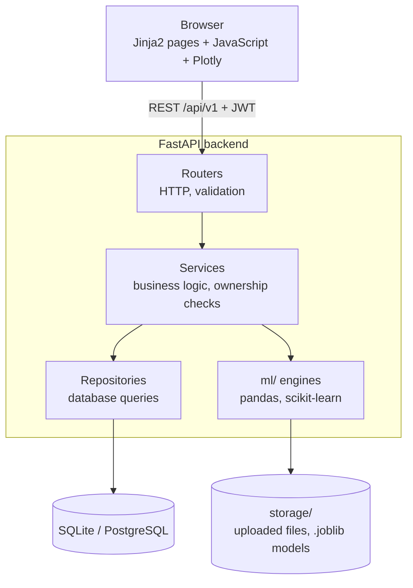
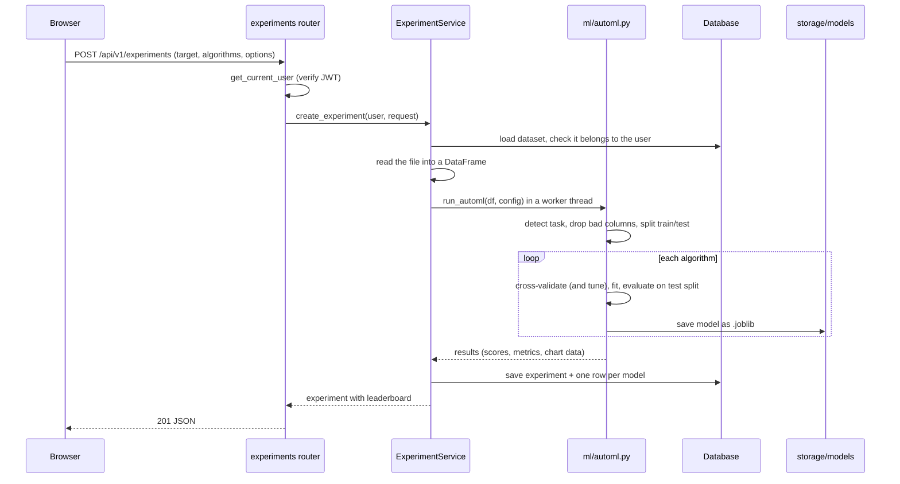
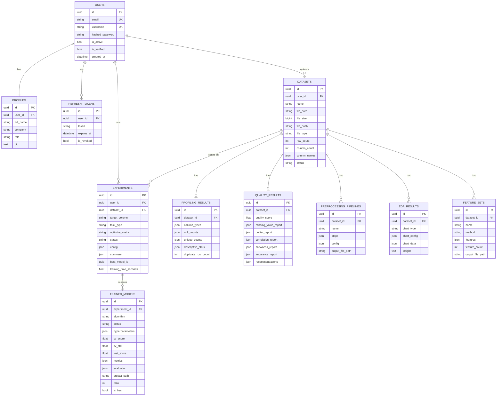
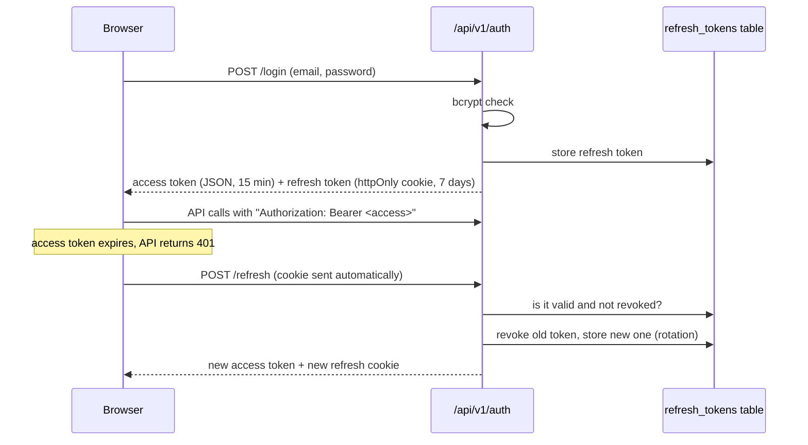

# AutoML BI Platform — Complete Project Guide

This is my single reference for the project: what it does, how it is built, why I chose each technology, the problems I hit, and how I'd answer interview questions about it. If you read this file top to bottom you should be able to explain any part of the project.

**Contents**

1. [The project in one minute](#1-the-project-in-one-minute)
2. [The problem it solves](#2-the-problem-it-solves)
3. [What a user can do (feature walkthrough)](#3-what-a-user-can-do)
4. [Tech stack: why this and not that](#4-tech-stack-why-this-and-not-that)
5. [Architecture](#5-architecture)
6. [Folder structure](#6-folder-structure)
7. [Database design and ER diagram](#7-database-design-and-er-diagram)
8. [API design](#8-api-design)
9. [How each module works](#9-how-each-module-works)
10. [Authentication and security](#10-authentication-and-security)
11. [Frontend](#11-frontend)
12. [Testing and CI](#12-testing-and-ci)
13. [Problems I faced and how I solved them](#13-problems-i-faced-and-how-i-solved-them)
14. [Limitations and how I would scale it](#14-limitations-and-how-i-would-scale-it)
15. [How to extend the project](#15-how-to-extend-the-project)
16. [ML concepts used, in plain English](#16-ml-concepts-used-in-plain-english)
17. [Interview questions and answers](#17-interview-questions-and-answers)
18. [Resume bullets and pitches](#18-resume-bullets-and-pitches)
19. [Running the project and demo script](#19-running-the-project-and-demo-script)
20. [Numbers to remember](#20-numbers-to-remember)

---

## 1. The project in one minute

A full-stack, no-code machine learning platform for tabular data (CSV or Excel). You upload a spreadsheet, and the app:

1. **profiles** every column (type, missing values, statistics),
2. gives the data a **quality score from 0 to 100**, with suggested fixes,
3. lets you **clean** it (fill missing values, handle outliers, scale, encode),
4. shows **EDA charts** and statistical tests,
5. lets you **engineer new features**,
6. **trains and compares up to 11 ML models automatically** (AutoML),
7. shows **evaluation** (leaderboard, confusion matrix, ROC curve, feature importance),
8. lets you **predict** through an API or **download** the trained model.

**Stack:** FastAPI (Python) backend, SQLAlchemy + SQLite/PostgreSQL, scikit-learn and pandas for ML, Jinja2 templates + Tailwind CSS + vanilla JavaScript + Plotly for the UI, JWT authentication, Docker, GitHub Actions CI, and 98 pytest tests.

---

## 2. The problem it solves

Building a model on business data normally means writing the same code every time: load the CSV, look for missing values, clean, encode categories, split the data, try a few models, compare them, plot results. That needs a data scientist and takes hours.

The idea is to give a non-programmer (an analyst, a small business, a student) a guided workflow in the browser that does all of this with good defaults, while still explaining *why* (for example: "this column was dropped because it looks like an ID").

**Who it is for:** analysts who know their data but not Python, and developers who want a quick baseline model before writing custom code.

---

## 3. What a user can do


| Step | What happens |
|---|---|
| Register / login | Account with JWT authentication. Password reset and change password. |
| Upload | CSV, XLSX or XLS up to 100 MB. Duplicate files are detected with a SHA-256 hash. |
| Profile | Each column is classified as numeric, categorical, boolean, datetime or text. Missing counts, unique counts, duplicates, min/max/mean/std. |
| Quality | Score 0–100 built from completeness, uniqueness, outliers, skew and correlation. Each issue comes with a recommended fix. |
| Preprocess | About 35 actions (imputation, outlier handling, scaling, transforms, encoding, resampling). You see a before/after preview, and applying it saves a **new dataset**, so the original is never changed. |
| EDA | Histograms, box plots, correlation heatmap, scatter plots, normality tests, and target-aware tests that rank how strongly each feature relates to the target. |
| Features | Date parts, interactions, polynomial terms, text statistics, PCA, mutual-information feature selection. Also saved as a new dataset. |
| AutoML | Pick a target column. The app detects the task type, recommends algorithms, trains them with cross-validation (optionally with hyperparameter tuning) and ranks them. |
| Evaluate | Leaderboard, metrics, confusion matrix, ROC and precision-recall curves, residual plots, feature importance. |
| Predict | Type values into a form (or call the API) to get a prediction. Download the model as a `.joblib` file. |

---

## 4. Tech stack: why this and not that

The rule I followed: **pick boring, well-known tools that I can explain, and keep the install small.** The whole runtime installs in about 350 MB and needs no GPU.

### Backend: FastAPI

**Why:** async support, request validation for free through Pydantic, and automatic interactive API docs at `/docs`. Dependency injection (`Depends`) makes things like "get the current user" and "get a DB session" one line per endpoint.

**Why not Django:** Django is great for admin-heavy CRUD apps, but it brings its own ORM, templates and conventions that I didn't need. My app is mostly a JSON API plus ML code, and FastAPI is lighter for that.

**Why not Flask:** Flask has no built-in validation, no automatic docs and no native async. I'd have had to add marshmallow, flasgger and so on.

### Database layer: SQLAlchemy 2.0 (async) + Alembic

**Why SQLAlchemy:** it is the standard Python ORM, works with both SQLite and PostgreSQL, and the 2.0 style with `Mapped[...]` type hints reads cleanly.

**Why async:** FastAPI is async, so database calls should not block the event loop while waiting for the DB.

**Why Alembic:** it versions the schema. Each change to the tables is a migration file, so any database can be upgraded with `alembic upgrade head`. CI runs `alembic check` to catch models that changed without a migration.

### Database: SQLite (development) and PostgreSQL (production)

**Why SQLite by default:** zero setup. Clone, install, run. Tests use in-memory SQLite, so they're fast.

**Why PostgreSQL in Docker:** real concurrency, proper types, production standard. Switching is one environment variable (`DATABASE_URL`).

**Why not MongoDB:** my data is relational (user → datasets → experiments → models) and I need foreign keys and cascading deletes. For the flexible parts (statistics, chart data), I use JSON columns inside SQL, which gives me the flexibility of documents without losing relations.

### Validation: Pydantic v2

Every request and response body is a Pydantic schema (`app/schemas/`). Bad input is rejected with a clear 422 error before my code runs. Settings (`app/config.py`) are also loaded from `.env` through Pydantic.

### ML: scikit-learn, pandas, NumPy, SciPy

**Why scikit-learn:** the standard for classical ML on tabular data. Its `Pipeline` object is the key to the whole AutoML design (see [section 9](#automl)).

**Why not deep learning (PyTorch/TensorFlow):** on tabular business data, tree ensembles (Random Forest, Gradient Boosting) usually match or beat neural networks, train in seconds on a CPU, and are easier to explain. PyTorch would add gigabytes to the install for no gain here.

**Why not an existing AutoML library (auto-sklearn, H2O, PyCaret):** they're heavy, hard to install on Windows, and a black box. Writing my own engine meant I could explain every decision and control it (which columns are dropped and why, how the winner is chosen).

**XGBoost / LightGBM:** used automatically if installed, but optional, to keep the base install small. scikit-learn's `HistGradientBoosting` is a similar algorithm and is always available.

**pandas:** reading CSV/Excel and all the column analysis. **SciPy:** statistical tests (Shapiro-Wilk, ANOVA, chi-square, Pearson/Spearman).

### Model storage: joblib

**Why:** joblib is the recommended way to save scikit-learn models. It's efficient for NumPy arrays inside models.

**Why not pickle:** joblib is pickle underneath, but faster for large arrays. **Why not ONNX:** it would let other languages load the model, but it adds a conversion step and doesn't support every sklearn transformer. Not needed for this scope.

### Frontend: Jinja2 + Tailwind CSS + vanilla JavaScript + Plotly

**Why server-rendered templates instead of React:** one codebase, one server, no build step, no Node toolchain. FastAPI serves the HTML pages; JavaScript on each page calls the JSON API. For a dashboard-style app this is simpler and fast enough.

**Why not React/Vue:** they would be the choice for a larger team or a very interactive UI, but they double the project (separate build, routing, state management). I'd migrate if the UI grew a lot.

**Why Tailwind:** utility classes keep styling inside the HTML, with no large custom CSS files. **Why Plotly.js:** interactive charts (zoom, hover) out of the box, and the backend can send chart-ready JSON. Chart.js is lighter but has weaker support for heatmaps and statistical charts; Matplotlib only produces static images.

### Authentication: JWT + bcrypt

**Why JWT:** stateless access tokens, so any server instance can verify a request without a session store. **Why also a refresh token stored in the database:** pure JWTs can't be revoked, so the long-lived refresh token is saved in the DB, which lets me log a user out and rotate tokens. Details in [section 10](#10-authentication-and-security).

**Why bcrypt:** a slow, salted password hash designed for passwords. A fast hash like SHA-256 can be brute-forced quickly. (Argon2 is the newer alternative; bcrypt is more widely used and well supported.)

### DevOps: Docker, Docker Compose, GitHub Actions

Docker gives the same environment everywhere; Compose starts PostgreSQL and the backend together. GitHub Actions runs migrations and all tests on every push.

### Testing: pytest + pytest-asyncio + httpx

pytest is the standard. httpx's `ASGITransport` calls the FastAPI app in-process, so API tests need no running server.

---

## 5. Architecture

### High-level view



### The layers and their single job

| Layer | Folder | Job | Must NOT do |
|---|---|---|---|
| Router | `app/routers/` | Define the URL, read the request, call the service, return the response | Contain business logic or SQL |
| Schema | `app/schemas/` | Pydantic models for request/response shapes | — |
| Service | `app/services/` | Business rules: check that the user owns the dataset, orchestrate steps, call the ML engine, save results | Know about HTTP details |
| Repository | `app/repositories/` | All SQLAlchemy queries for one table | Contain business rules |
| Model | `app/models/` | SQLAlchemy table definitions | — |
| ML engine | `app/ml/` | Pure Python functions on DataFrames | Import FastAPI or the database |

**Why layers:** each layer can be changed or tested on its own. The ML engine has zero web or database code, so I can unit-test it with a DataFrame and nothing else. If I switched from FastAPI to something else, `ml/` wouldn't change. It also makes debugging easier: an HTTP problem is in the router, a wrong number is in `ml/`, a missing record is in the repository.

### Request lifecycle: training a model



**Why a worker thread (`run_in_threadpool`):** training is CPU-heavy. FastAPI runs on a single async event loop; if training ran directly on it, every other user's request would wait. Running it in a thread keeps the server responsive.

### Other design decisions

- **Every query is scoped by user.** Services always look up a dataset by `(dataset_id, user_id)`. Another user's dataset returns **404, not 403**, so you can't even learn that it exists.
- **Processed data is saved as a new dataset.** Preprocessing and feature engineering never overwrite the original file. You can always go back.
- **Centralized errors.** Services raise `NotFoundException`, `BadRequestException` and so on (`app/core/exceptions.py`); one handler converts them to JSON. Unexpected errors are logged with a traceback and return a clean 500 JSON message.
- **Settings in one place.** `app/config.py` reads `.env`. No hard-coded secrets or paths elsewhere.

---

## 6. Folder structure

```
auto_ml_pipline/
├── backend/
│   ├── app/
│   │   ├── main.py            # creates the app, registers routers and handlers
│   │   ├── config.py          # settings from .env
│   │   ├── database.py        # async engine, session, Base
│   │   ├── dependencies.py    # get_current_user (JWT -> User)
│   │   ├── core/              # security (JWT, bcrypt), exceptions, logging
│   │   ├── models/            # SQLAlchemy tables
│   │   ├── schemas/           # Pydantic request/response models
│   │   ├── repositories/      # database queries
│   │   ├── services/          # business logic
│   │   ├── routers/           # API endpoints + pages.py (HTML pages)
│   │   ├── ml/                # profiler, quality, preprocessor, EDA, features, automl, evaluator
│   │   └── utils/dataset_io.py  # read CSV/Excel into a DataFrame
│   ├── alembic/versions/      # 9 database migrations
│   └── tests/                 # 98 pytest tests
├── frontend/
│   ├── templates/             # base layouts, components, pages, error pages
│   └── static/                # css/main.css, js/ (one file per page + api.js, utils.js)
├── storage/                   # uploads/ and models/ (gitignored contents)
├── docker/Dockerfile.backend
├── docker-compose.yml
└── .github/workflows/ci.yml
```

A feature always touches the same set of files, which makes the code predictable. For example, "quality" is `models/quality.py`, `schemas/quality.py`, `repositories/quality_repository.py`, `services/quality_service.py`, `routers/quality.py`, `ml/quality_analyzer.py`, `templates/pages/quality.html`, `static/js/quality.js` and `tests/test_quality.py`.

---

## 7. Database design and ER diagram



**11 tables.** The design decisions I'd explain:

- **UUID primary keys** instead of 1, 2, 3. IDs appear in URLs, and sequential IDs let anyone guess other records. UUIDs also make merging data from different databases safe.
- **JSON columns for analysis results.** A profiling result has a different number of columns for every dataset, so a fixed table structure doesn't fit. JSON keeps it flexible, while the main entities (users, datasets, experiments) stay properly relational.
- **Files on disk, paths in the database.** Uploaded files and models can be hundreds of MB. Databases are bad at storing large blobs; the DB stores only the path, size and hash.
- **`ON DELETE CASCADE` everywhere.** Deleting a user deletes their datasets; deleting a dataset deletes its profile, quality report, charts, pipelines, feature sets and experiments. SQLite ignores foreign keys unless `PRAGMA foreign_keys=ON` is set on each connection, so `database.py` turns it on.
- **`file_hash` is indexed** so the duplicate-upload check is a fast lookup.
- **Refresh tokens are stored** so they can be revoked (logout, password change).
- **One profiling result and one quality result per dataset** (re-running replaces them); many charts, pipelines, feature sets and experiments per dataset.

---

## 8. API design

REST, JSON, versioned under `/api/v1`, documented automatically at `/docs`. **45 endpoints.** Dataset features are nested under the dataset they belong to (`/datasets/{id}/quality`), which makes ownership obvious from the URL.

| Area | Endpoints |
|---|---|
| Auth (8) | `POST /auth/register`, `/login`, `/refresh`, `/logout`, `/forgot-password`, `/reset-password`, `/change-password`, `GET /auth/me` |
| Users (2) | `GET`, `PUT /users/profile` |
| Dashboard (3) | `GET /dashboard/summary`, `/recent-datasets`, `/notifications` |
| Datasets (6) | `POST /datasets/upload`, `GET /datasets/`, `GET`/`DELETE /datasets/{id}`, `GET /{id}/preview`, `GET /{id}/download` |
| Profiling (2) | `POST`/`GET /datasets/{id}/profile` |
| Quality (2) | `POST`/`GET /datasets/{id}/quality` |
| Preprocessing (5) | `POST /preprocess/analyze`, `/preview`, `/apply`; `GET /preprocess/pipelines`, `/pipelines/{pid}` |
| EDA (4) | `POST /eda/generate`, `/eda/custom`; `GET /eda`, `/eda/bivariate` |
| Features (4) | `POST /features/generate`; `GET /features`, `/features/{fid}`; `POST /features/{fid}/apply` |
| Experiments (8) | `GET /experiments/recommend`, `POST`/`GET /experiments/`, `GET`/`DELETE /experiments/{id}`, `GET /{id}/models/{mid}`, `/download`, `POST /predict` |
| Health (1) | `GET /health` |

**Conventions:**
- `POST` runs an analysis and stores the result; `GET` reads the stored result. So the frontend can show old results instantly without recomputing.
- Status codes: 201 created, 400 invalid request (with a readable message), 401 not logged in, 404 not found or not yours, 409 duplicate, 422 schema validation failed.
- HTML pages are served separately by `app/routers/pages.py` and are excluded from the API docs.

---

## 9. How each module works

### Upload (`services/dataset_service.py`)

1. Check the extension (`.csv`, `.xlsx`, `.xls`).
2. Check the size against `MAX_UPLOAD_SIZE` (100 MB).
3. Compute a **SHA-256 hash** of the content. If this user already uploaded the same file → 409 Conflict.
4. Parse with pandas to get rows, columns and column names (this also proves the file is readable).
5. Save the file under `storage/uploads/` and create the `datasets` row.

### Profiling (`ml/profiler.py`)

For each column, detect a type:
- **boolean** — at most 2 values, like true/false, yes/no, 0/1,
- **numeric** — numbers,
- **datetime** — strings where 80%+ of a 100-row sample parse as dates,
- **categorical** — few distinct values (under 20, or under 5% of rows),
- **text** — everything else (free text, IDs).

Then compute missing counts, unique counts, duplicate rows, and descriptive stats (mean, std, min, quartiles, max for numbers; most frequent values for categories).

### Data quality score (`ml/quality_analyzer.py`)

Five sub-scores, each 0–100, combined with weights:

| Dimension | How it is measured | Weight |
|---|---|---|
| Completeness | % of cells that are not missing | 30% |
| Uniqueness | % of rows that are not duplicates | 20% |
| Outlier-free | % of rows with no IQR outlier | 20% |
| Distribution | % of numeric columns that are not highly skewed (abs(skew) ≤ 1.5) | 15% |
| Independence | % of numeric columns not highly correlated (abs(r) > 0.85) with another | 15% |

`score = 0.30·completeness + 0.20·uniqueness + 0.20·outlier_free + 0.15·distribution + 0.15·independence`

**Why these weights:** missing data hurts models most, so it has the highest weight. Duplicates and outliers come next. Skew and correlation matter less because tree models handle them reasonably well.

**Outliers (IQR rule):** Q1 and Q3 are the 25th and 75th percentiles, IQR = Q3 − Q1. Values below Q1 − 1.5·IQR or above Q3 + 1.5·IQR are outliers. I use IQR instead of Z-score as the main rule because IQR isn't distorted by the outliers themselves and works on skewed data.

Every issue produces a **recommendation that uses a real preprocessing action name**, so the preprocessing page can pre-fill it with one click.

### Preprocessing (`ml/preprocessor.py`)

The user builds a list of steps like `{"column": "age", "action": "impute_median"}`. The engine applies them in order on a **copy** of the data.

| Group | Actions |
|---|---|
| Missing values | mean, median, mode, constant, random sample, end-of-distribution, drop rows (complete-case), **KNN imputer**, **iterative imputer (MICE)** |
| Outliers | cap at IQR fences, drop rows, replace with median/mean, set to missing |
| Scaling | standard (z-score), min-max, robust |
| Transforms | log, square root, reciprocal, Box-Cox, Yeo-Johnson |
| Binning | equal width, equal frequency, k-means, binarize |
| Encoding | one-hot, label |
| Other | drop column, drop correlated column, drop duplicates, extract datetime parts, over/under-sampling for class imbalance |

Flow: **analyze** (suggest steps) → **preview** (first rows and stats before/after, nothing saved) → **apply** (save as a new dataset and record the pipeline). Unknown actions or wrong column types return a 400 that names the failing step.

### EDA (`ml/eda_generator.py`)

- **Summary charts:** histograms, box plots, missing-value chart, category counts, correlation heatmap, each with a short written insight.
- **Custom charts:** the user picks columns and chart type.
- **Normality test:** Shapiro-Wilk for up to 5,000 rows, Kolmogorov-Smirnov above that.
- **Target-aware analysis:** pick a target, and every feature is tested against it with the right test for the type pair:

| Feature type | Target type | Test | Strength measure |
|---|---|---|---|
| numeric | numeric | Pearson and Spearman correlation | r |
| numeric | categorical | ANOVA (Kruskal-Wallis is used to pick the top features for charts, since it doesn't assume normal data) | eta² |
| categorical | categorical | Chi-square test | Cramér's V |

Features are then ranked by strength, which tells the user which columns matter before training.

### Feature engineering (`ml/feature_engineer.py`)

| Method | What it creates |
|---|---|
| date | year, month, day, day of week, hour, is_weekend from a date column |
| interaction | product (a×b) and ratio (a/b) for a chosen pair of columns |
| polynomial | squared and cubed versions of chosen columns |
| text | character length and word count of a text column |
| PCA | principal components (compressed versions of many numeric columns) |
| selection | keep the top-k columns by mutual information with the target |

### AutoML (`ml/automl.py`) <a id="automl"></a>

This is the core of the project.

**Step 1 — Detect the task** from the target column:
- 2 distinct values → **binary classification**
- text/boolean, or whole numbers with ≤ 20 distinct values (and under 50% unique) → **multiclass classification**
- any other numbers → **regression**

The rules are simple on purpose so they're easy to explain and test. The user can override them.

**Step 2 — Prepare the data.** Drop rows where the target is missing. Drop columns that would hurt or leak, and **record a reason for each**:
- ID-like columns (about 95%+ unique and consecutive, or named like `id`, `customer_id`, `row_num`),
- constant columns,
- free text with more than 50 categories,
- raw date strings (with a hint to use the date feature tool).

Label-encode the target for classification. Down-sample to 50,000 rows if larger (`AUTOML_MAX_ROWS`).

**Step 3 — Build one Pipeline per algorithm:**

```
numeric columns     → fill missing with median → standard scale ─┐
                                                                  ├─→ model
categorical columns → fill missing with mode   → one-hot encode ──┘
```

This is a scikit-learn `Pipeline` with a `ColumnTransformer`. **The preprocessing is inside the pipeline, so it is re-fit on each cross-validation fold.** That prevents data leakage (see [section 16](#16-ml-concepts-used-in-plain-english)), and the saved model accepts raw rows directly.

**Step 4 — Split** 80% train / 20% test (stratified for classification, so class ratios are kept).

**Step 5 — Cross-validate** each algorithm on the training part with 5-fold CV (stratified for classification). If tuning is on, `RandomizedSearchCV` tries N random hyperparameter combinations instead.

**Step 6 — Refit** on the whole training part and **evaluate on the test part**, which was never used to choose anything.

**Step 7 — Rank** by CV score (not test score) and mark the best. **Step 8 — Save** each model as a `.joblib` bundle (pipeline + feature lists + class labels + task type).

**If one algorithm crashes,** it is marked `failed` with the error message and the others continue.

**Algorithms (11 built in):**

| Algorithm | Classification | Regression | Notes |
|---|---|---|---|
| Logistic Regression | ✓ | | baseline |
| Linear, Ridge, Lasso, ElasticNet | | ✓ | linear baseline with/without regularization |
| Decision Tree | ✓ | ✓ | easy to interpret |
| Random Forest | ✓ | ✓ | strong default |
| Extra Trees | ✓ | ✓ | more random, faster forest |
| Histogram Gradient Boosting | ✓ | ✓ | sklearn's fast boosting, similar to LightGBM |
| KNN | ✓ | ✓ | only recommended under 5,000 rows |
| SVM / SVR | ✓ | ✓ | only recommended under 5,000 rows |

XGBoost and LightGBM are added automatically if installed.

**Default metric:** weighted F1 for classification (robust to imbalanced classes), R² for regression. The user can pick accuracy, ROC-AUC, precision, recall, RMSE or MAE.

### Evaluation (`ml/evaluator.py`)

On the held-out test split:
- **Classification:** accuracy, precision, recall, F1 (weighted and macro), ROC-AUC, log loss, confusion matrix, per-class report, ROC curve, precision-recall curve.
- **Regression:** MAE, MSE, RMSE, R², adjusted R², MAPE, predicted-vs-actual scatter, residuals.
- **Both:** **permutation feature importance** on the original columns.

Everything is converted to plain JSON (NaN and infinity become `null`) with the shared helper `ml/json_utils.py`. Curves are thinned to at most 100 points to keep responses small.

### Prediction

`POST /experiments/{id}/models/{mid}/predict` with rows like `[{"age": 42, "plan": "premium"}]`. The service loads the `.joblib`, builds a DataFrame with the expected columns, runs the pipeline, and returns the label (decoded back to the original class name) plus probabilities.

---

## 10. Authentication and security



- **Two tokens.** The short-lived access token (15 minutes) limits damage if stolen. The refresh token lives in an **httpOnly cookie**, so JavaScript (and therefore an XSS attack) can't read it. The cookie is limited to the `/api/v1/auth` path.
- **Rotation.** Every refresh revokes the old refresh token and issues a new one.
- **Token types.** Each JWT has a `type` claim (`access`, `refresh`, `reset`), and each verifier accepts only its own type. A refresh token can't be used as an access token.
- **Revocation.** Logout revokes the refresh token. Changing or resetting the password revokes all of the user's refresh tokens (signs out other devices).
- **Passwords** are hashed with bcrypt (salted, deliberately slow).
- **Forgot password** gives the same response whether or not the email exists, so attackers can't find out which emails are registered.
- **Authorization:** every query is scoped by `user_id`; other users' resources return 404.
- **XSS:** anything user-controlled (file names, CSV headers and cells) goes through `escapeHtml()` before being inserted into the page.
- **Input limits:** file type and size checks, row limits on previews (`le=500`), Pydantic validation on every body.
- **Secrets:** `SECRET_KEY` comes from `.env`; the app logs a warning at startup if it's still the default.

---

## 11. Frontend

- **Template inheritance:** `base.html` (head, scripts) → `base_dashboard.html` (sidebar + navbar layout) → each page. Shared pieces are in `templates/components/` (sidebar, navbar, dataset sub-navigation, an SVG icon macro).
- **One JS file per page** (`upload.js`, `quality.js`, `experiment_detail.js`...) plus shared files: `api.js` (fetch wrapper that adds the token and retries once after refreshing on a 401), `utils.js` (formatting, `escapeHtml`, toasts), `main.js` (auth check, theme, navbar).
- **How a page works:** FastAPI returns the HTML shell → the JS checks the session with `/auth/me` → calls the API → renders tables and Plotly charts.
- **Light and dark theme**, responsive layout, loading and empty states.

---

## 12. Testing and CI

**98 tests**, run with `pytest tests -q` from `backend/` in about 40 seconds.

| Test file | Covers |
|---|---|
| `test_auth.py` | register, login, refresh rotation, logout, token-type checks, password reset, change password |
| `test_datasets.py` | upload, duplicates, wrong file type, list, preview, delete |
| `test_profiling.py`, `test_quality.py` | type detection, score, outliers, correlation, imbalance, recommendations |
| `test_preprocessing.py`, `test_eda.py`, `test_features.py` | each engine plus its endpoints and access control |
| `test_automl_engine.py` | task detection, column dropping, every task type, tuning, error-metric ranking, failure isolation (no HTTP, no DB) |
| `test_experiments.py` | full train → evaluate → predict → download → delete flow, validation errors, another user's access |
| `test_regressions.py` | one test per real bug found during end-to-end testing |
| `test_dashboard.py` | summary counts |

**How the tests are set up (`conftest.py`):** an in-memory SQLite database and a temporary storage folder per test session; FastAPI's `get_db` dependency is overridden to use the test database. Tests never touch real data.

**CI (`.github/workflows/ci.yml`)** on every push and pull request to `main`:
1. install `requirements-dev.txt`,
2. `alembic upgrade head` and `alembic check` (fails if models and migrations disagree),
3. `pytest`.

I also ran an end-to-end pass: a deliberately messy CSV through every endpoint, and a Playwright browser run that clicked through every page and failed on any JavaScript error.

---

## 13. Problems I faced and how I solved them

These are real bugs from this project. They make good interview stories.

**1. Refresh tokens worked as access tokens.**
*Problem:* the token creation function always overwrote the `type` claim with `"access"`, so a refresh token (valid 7 days) could be used as a bearer token, and password-reset tokens never validated.
*Fix:* a separate `type` per token and verifiers that only accept their own type, plus regression tests for each case.
*Lesson:* test the negative cases too: "a refresh token must be rejected here".

**2. Data leakage in model evaluation.**
*Problem:* if you scale or impute the whole dataset before cross-validation, the validation folds influence the preprocessing and the scores look better than they really are.
*Fix:* put all preprocessing inside the sklearn `Pipeline`, so it's re-fit inside each fold. I also select the best model by CV score and report the test score separately.

**3. ID columns leaking into models.**
*Problem:* a `customer_id` column can look like a useful number. My first check (100% unique) failed when the data had duplicate rows, because then the ID is only ~98% unique.
*Fix:* treat a column as an ID if it is ~95%+ unique and either consecutive or named like an ID, and show the user why it was dropped.

**4. Deleting a dataset crashed with an IntegrityError.**
*Problem:* child rows (charts, pipelines, feature sets) blocked the delete, and SQLite was silently ignoring `ON DELETE CASCADE`.
*Fix:* ORM cascade on every child relationship, plus `PRAGMA foreign_keys=ON` for SQLite. Deleting a dataset also deletes its model files from disk.

**5. pandas 3 broke preprocessing.**
*Problem:* label encoding, k-means binning and random imputation changed a column's dtype in place, which newer pandas rejects.
*Fix:* build a complete new column and assign it, instead of modifying values in place.

**6. "KNN" and "MICE" imputation weren't real.**
*Problem:* they were filling with the median and ignored the other columns.
*Fix:* use sklearn's real `KNNImputer` and `IterativeImputer`, which use the other numeric columns to estimate the missing value.

**7. Stored XSS.**
*Problem:* dataset names and CSV headers were inserted with `innerHTML`, so a column named `` would run code.
*Fix:* an `escapeHtml()` helper applied everywhere user data is rendered.

**8. SVM had no probabilities.**
*Problem:* ROC-AUC needs probabilities, and `SVC(probability=True)` is slow and deprecated in the docs.
*Fix:* wrap SVC in `CalibratedClassifierCV`. For SVR, I also scale the target, which raised its cross-validated R² from 0.14 to 0.95 on a sample dataset.

**9. Long training blocked the server.**
*Problem:* while one user trained models, the whole API froze.
*Fix:* run training with `run_in_threadpool`.

**10. The reset-password page could never submit.**
*Problem:* the strength-check function returned nothing, so every password counted as "too weak".
*Fix:* return a strength level using the same rules as the server. Found only by the browser walkthrough, which is why I added it.

---

## 14. Limitations and how I would scale it

I'd mention these before being asked.

| Limitation | Production fix |
|---|---|
| Training runs inside the HTTP request (fine up to the 50k-row cap) | A task queue (Celery or RQ with Redis): return a job ID right away, train in a worker, poll for progress |
| Files on local disk | Object storage (S3 / Azure Blob) |
| Uploads are read into memory before the size check | Stream to disk in chunks and stop at the limit |
| Randomized hyperparameter search | Optuna (Bayesian search) for better results in fewer trials |
| No email service, so reset links only appear in debug mode | Send through SendGrid / AWS SES |
| Refresh cookie has `secure=False` for local HTTP | Set `secure=True` behind HTTPS |
| Preprocessing page transforms are fit on all rows | Fine for exploring; the AutoML pipeline itself is leakage-safe |
| No model monitoring | Track prediction drift and retrain |

**Scaling plan:** PostgreSQL, several uvicorn workers behind Nginx, Redis + Celery workers for training, S3 for files, and the app stays stateless (JWT) so it can scale horizontally.

---

## 15. How to extend the project

The layered structure makes changes follow the same recipe.

**Add a new ML algorithm:** add an `AlgorithmSpec` to `_build_registry()` in `ml/automl.py` with a key, name, supported tasks, a factory function and (optionally) a `param_space` for tuning. It then automatically appears in recommendations, training and the UI. Add a test in `test_automl_engine.py`.

**Add a new preprocessing action:** add its name to the right set at the top of `ml/preprocessor.py` (`NUMERIC_ACTIONS` or `ANY_COLUMN_ACTIONS`), handle it in `apply()`, and add the option to `templates/pages/preprocessing.html`.

**Add a new feature (a whole module):**
1. `models/x.py` + an Alembic migration (`alembic revision --autogenerate -m "add x"`),
2. `schemas/x.py`,
3. `repositories/x_repository.py`,
4. `ml/x.py` (pure logic),
5. `services/x_service.py` (ownership check + orchestration),
6. `routers/x.py`, registered in `main.py`,
7. a page in `routers/pages.py` + template + JS,
8. `tests/test_x.py`.

**Debugging tips:**
- `/docs` lets you call any endpoint by hand.
- Logs go to the console and `backend/logs/`. Unexpected errors log a full traceback.
- Wrong number → look in `ml/`. 404 → check the ownership query in the service. 422 → the request body doesn't match the Pydantic schema.

---

## 16. ML concepts used, in plain English

| Term | Meaning |
|---|---|
| Classification / regression | Predicting a category (churn yes/no) vs predicting a number (price) |
| Train / test split | Keep 20% of the data hidden during training to check how the model does on unseen data |
| Cross-validation (k-fold) | Split the training data into k parts; train on k−1, validate on the last; repeat k times and average. A more reliable score than one split |
| Stratified | Every split keeps the same class proportions as the full data. Important when one class is rare |
| Data leakage | Information from the validation/test data sneaking into training, which makes scores look better than reality |
| Pipeline | A chain of steps (impute → scale → encode → model) that acts as one object. Fitting it fits every step on the same data |
| Imputation | Filling missing values (median, mode, KNN uses similar rows, MICE predicts each column from the others) |
| Scaling | Putting numbers on a similar range. Needed for distance-based models (KNN, SVM) and linear models; trees don't care |
| One-hot encoding | Turning a category like `plan = basic/premium` into 0/1 columns |
| Label encoding | Turning categories into 0, 1, 2. Used for the target |
| Outlier (IQR rule) | A value far outside the middle 50% of the data |
| Skewness | How lopsided a distribution is. Log / Yeo-Johnson transforms reduce it |
| Correlation | How strongly two numeric columns move together (−1 to 1) |
| Hyperparameters | Settings chosen before training (number of trees, depth) |
| RandomizedSearchCV | Try N random combinations of hyperparameters, each scored with cross-validation |
| Accuracy | % of predictions that are correct. Misleading when classes are imbalanced |
| Precision / recall | Precision: of predicted positives, how many were right. Recall: of real positives, how many we found |
| F1 | Balance of precision and recall. "Weighted" averages over classes by their size |
| ROC-AUC | How well the model ranks positives above negatives, from 0.5 (random) to 1.0 (perfect) |
| Confusion matrix | Table of actual vs predicted classes, showing which mistakes the model makes |
| MAE / RMSE | Average error in the target's units. RMSE punishes big errors more |
| R² | Share of the variation the model explains. 1 is perfect, 0 is no better than predicting the average |
| Permutation importance | Shuffle one column and see how much the score drops. A big drop means the column is important |
| PCA | Compress many correlated columns into fewer "components" |
| Mutual information | How much knowing a feature tells you about the target. Catches non-linear relationships |
| Chi-square / Cramér's V | Test whether two categorical columns are related, and how strongly (0 to 1) |
| ANOVA | Test whether a numeric value's average differs between groups |
| Calibration | Adjusting a model's scores so they behave like real probabilities |

---

## 17. Interview questions and answers

### About the project

**Q: Walk me through your project.**
It's a no-code AutoML platform. You upload a CSV and go through profiling, a quality score, cleaning, EDA and feature engineering, then the app trains and compares up to 11 scikit-learn models and shows a leaderboard with ROC curves, a confusion matrix and feature importance. You can predict through an API or download the model. The backend is FastAPI with a layered architecture (routers, services, repositories, and a separate ML package), the database is SQLAlchemy on SQLite or PostgreSQL, and it has 98 tests and CI.

**Q: What was the hardest part?**
Getting the evaluation honest. It's easy to get great-looking scores that are wrong because of leakage. I put all preprocessing inside the sklearn pipeline so it's re-fit inside each CV fold, picked the best model by CV score, and kept a test split that's only used for the final report.

**Q: What would you do differently?**
Start with a task queue for training from day one, and write the end-to-end browser test earlier, because it found bugs the unit tests didn't.

### Backend

**Q: Why FastAPI?** Async, validation with Pydantic, automatic docs, and dependency injection. See [section 4](#4-tech-stack-why-this-and-not-that).

**Q: What is dependency injection in your code?**
Endpoints declare what they need, like `current_user: User = Depends(get_current_user)` and `db: AsyncSession = Depends(get_db)`. FastAPI builds those before calling the function. In tests I override `get_db` to use an in-memory database.

**Q: Why the repository pattern?**
All SQL for a table is in one place. Services read like business rules, and if a query needs optimizing, I change one file.

**Q: What does async give you? Isn't ML CPU-bound?**
Async helps with I/O (database, file reads), so one process can serve many requests while waiting. CPU-bound training would block the event loop, so I run it in a thread pool with `run_in_threadpool`.

**Q: How do you handle errors?**
Custom exception classes per HTTP status, raised in services and turned into JSON by one handler. A last-resort handler logs the traceback and returns a clean 500.

**Q: How do migrations work?**
Each schema change is an Alembic revision. `alembic upgrade head` applies them in order. CI runs `alembic check` to make sure the models and the migrations match.

### Database

**Q: Explain your schema.** Users own datasets; a dataset has one profile, one quality report, and many charts, pipelines, feature sets and experiments; an experiment has many trained models. See the [ER diagram](#7-database-design-and-er-diagram).

**Q: Why JSON columns? Isn't that bad design?**
Only for analysis output whose shape depends on the dataset (per-column statistics, chart data). I never filter or join on those fields. The entities I query on are normal columns with foreign keys.

**Q: Why UUIDs?** They're not guessable in URLs and are safe to generate anywhere.

**Q: Why not store files in the database?** Large blobs slow down the database and backups. Disk (or S3) plus a path in the DB is the standard approach.

### ML

**Q: How does task detection work?** See [AutoML step 1](#automl). Two values → binary; text or few whole numbers → multiclass; otherwise regression.

**Q: Why rank by CV score and not test score?**
If I choose the best of 11 models by test score, I've effectively tuned on the test set and the reported number is optimistic. CV chooses; the test set only reports.

**Q: Why weighted F1 as default?** Accuracy is misleading with imbalanced classes (95% "no churn" gives 95% accuracy by always saying "no"). F1 balances precision and recall.

**Q: How do you handle class imbalance?** Stratified splits and folds, weighted F1, precision-recall curves, the quality report flags imbalance, and the preprocessing page offers over/under-sampling.

**Q: Why permutation importance instead of `feature_importances_`?**
It works for every model (linear, KNN, SVM), it's measured on held-out data, it's reported on the original columns instead of one-hot columns, and tree-based importances are biased toward columns with many unique values.

**Q: Why do KNN and SVM need scaling but trees don't?**
KNN and SVM use distances, so a column in thousands (salary) would dominate a column in single digits. Trees split on one column at a time with thresholds, so scale doesn't matter.

**Q: Why is SVM wrapped in `CalibratedClassifierCV`?** SVMs don't output probabilities, which ROC-AUC needs. Calibration provides them.

**Q: What's in the `.joblib` file?** The fitted pipeline plus metadata: feature columns, numeric/categorical lists, class labels and task type. It can be loaded with `joblib.load` and used outside the app.

**Q: Why random search and not grid search?** Grid search tries every combination, which grows very fast. Random search with the same budget usually finds equally good settings because only a few hyperparameters really matter.

**Q: What if an algorithm fails?** It's recorded as failed with the error, and the others continue.

**Q: Why not deep learning?** Tabular data, CPU-only, small installs, and tree ensembles are usually as good or better on this kind of data.

### Security

**Q: Where is the token stored?** The access token is in memory/sessionStorage and sent in the `Authorization` header; the refresh token is in an httpOnly cookie that JavaScript can't read.

**Q: How do you log someone out if JWTs are stateless?** Access tokens expire in 15 minutes. Refresh tokens are stored in the DB and revoked on logout or password change.

**Q: How do you stop users seeing each other's data?** Every query filters by `user_id`, and other users' resources return 404.

**Q: Why bcrypt?** It's salted and intentionally slow, so brute-forcing a leaked hash is expensive.

### Testing and DevOps

**Q: How did you test it?** 98 pytest tests with an in-memory database (unit tests for the ML engine, API tests for each module, regression tests for real bugs), CI on GitHub Actions, and a Playwright browser walkthrough.

**Q: What does Docker Compose run?** PostgreSQL with a health check, and the backend, which runs migrations and then starts uvicorn.

**Q: How would you deploy it?** Docker image on a VM or a container service (Azure App Service, AWS ECS), managed PostgreSQL, S3 for files, Nginx with HTTPS in front.

---

## 18. Resume bullets and pitches

**One line:**
> Full-stack AutoML platform (FastAPI, scikit-learn, SQLAlchemy) that takes a CSV from upload through profiling, data-quality scoring, preprocessing, EDA and feature engineering to automated model training, evaluation and a prediction API.

**Bullets (pick 3–4):**
- Built a full-stack AutoML platform with **FastAPI and scikit-learn** that automates the tabular ML workflow (upload, profiling, data-quality scoring, preprocessing, EDA, feature engineering, training and evaluation) across **45 REST endpoints**.
- Designed an AutoML engine that detects the task type, recommends algorithms by data size, and trains **11 algorithms** as leakage-safe sklearn **Pipelines** with **stratified k-fold cross-validation** and **randomized hyperparameter search**.
- Implemented model evaluation with a leaderboard, **ROC / precision-recall curves**, confusion matrix, residual analysis and **permutation feature importance**, rendered interactively with Plotly.
- Secured the app with **JWT access/refresh tokens (rotation and revocation)**, bcrypt, per-user data isolation and XSS-safe rendering; served models through an authenticated prediction API and `.joblib` export.
- Wrote **98 automated tests**, **9 Alembic migrations** checked in **GitHub Actions CI**, and Docker Compose deployment on PostgreSQL.

**30-second pitch:**
"It's a no-code machine learning platform. You upload a spreadsheet; it profiles every column, gives the data a quality score with fixes, lets you clean and explore it, and then trains and compares up to eleven models automatically. You get a leaderboard, ROC curves, a confusion matrix and feature importance, and you can call the best model through an API or download it. The backend is FastAPI with a layered architecture and the ML is all scikit-learn, so it runs on any laptop."

---

## 19. Running the project and demo script

**Local (SQLite):**

```bash
cd backend
python -m venv venv
venv\Scripts\activate          # Windows  (source venv/bin/activate on Mac/Linux)
pip install -r requirements-dev.txt
copy .env.example .env         # then set SECRET_KEY
alembic upgrade head
uvicorn app.main:app --reload
```

Open http://localhost:8000 (app) and http://localhost:8000/docs (API).

**Docker (PostgreSQL):** `docker compose up --build`

**Tests:** `cd backend && pytest tests -q`

**Demo order (about 5 minutes):**
1. Register and upload a churn CSV. Mention the duplicate check.
2. Profiling: automatic types. Quality: the score and its recommendations.
3. EDA: pick the target, show the statistical tests ranking features.
4. Train Models: select the target; the app detects binary classification and pre-selects algorithms. Turn on tuning and train.
5. Leaderboard: explain CV-based ranking vs the test score. Show the confusion matrix, ROC curve and feature importance.
6. Make a prediction, download the `.joblib`, and say it's a plain sklearn pipeline usable anywhere.
7. Open `/docs` to show the API.

---

## 20. Numbers to remember

| | |
|---|---|
| REST endpoints | 45 |
| Database tables | 11 |
| Alembic migrations | 9 |
| Automated tests | 98 |
| Built-in algorithms | 11 (+ XGBoost/LightGBM if installed) |
| Preprocessing actions | ~35 |
| Upload limit | 100 MB, CSV/XLSX/XLS |
| AutoML row cap | 50,000 (down-sampled above) |
| Default split / CV | 80/20, 5-fold |
| Access / refresh token life | 15 minutes / 7 days |
| Install size | ~350 MB, no GPU |
